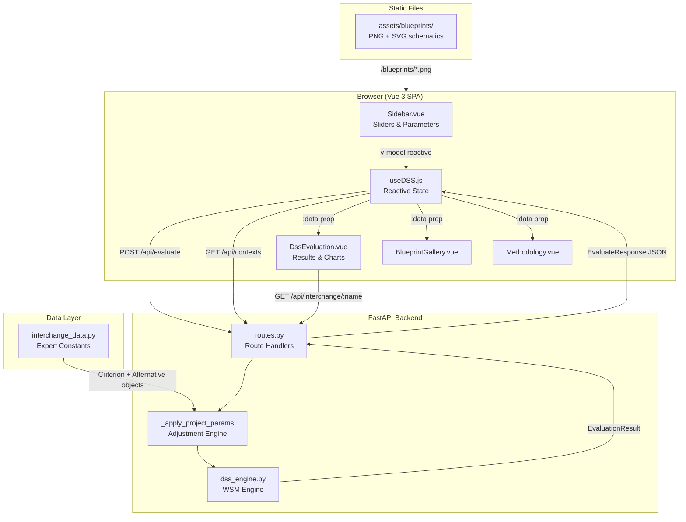
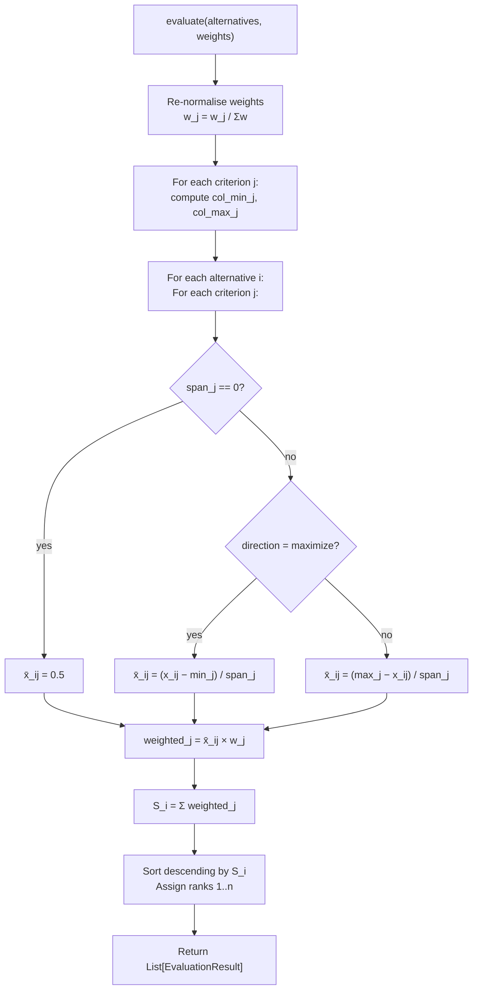
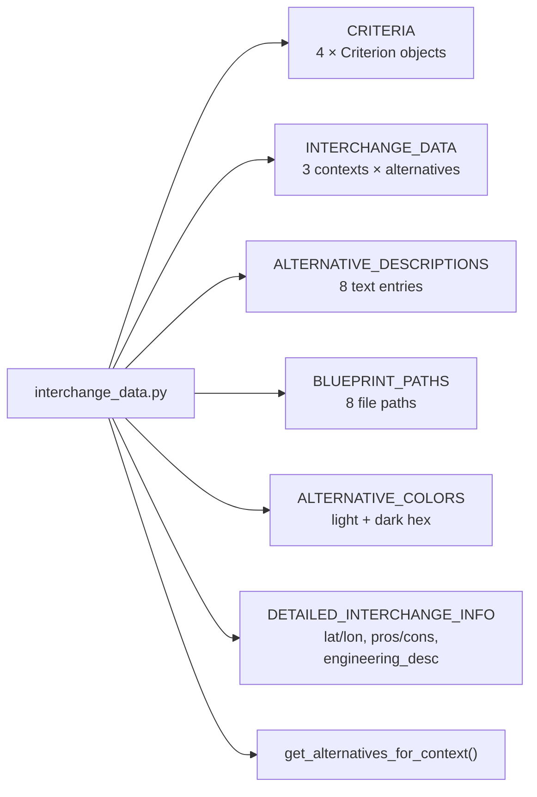
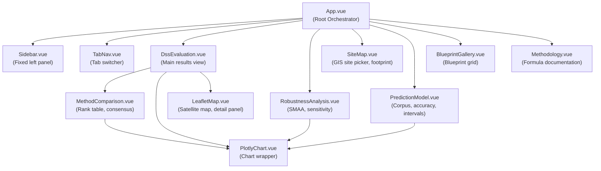
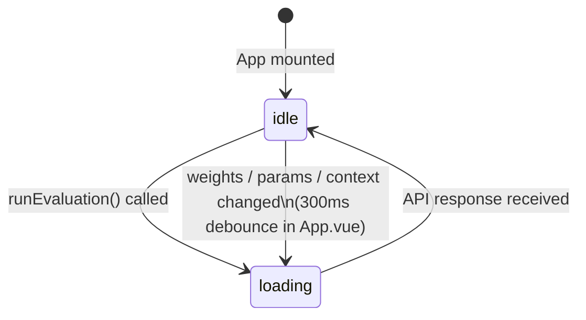
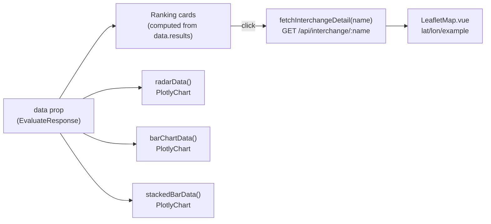
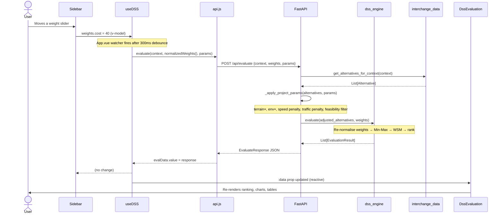
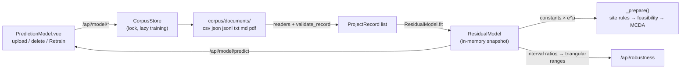

# TDSS v5 — Transport Interchange Decision Support System

> **Academic / Engineering Tool** — Multi-Criteria Decision Analysis for Highway Interchange Selection

---

## Table of Contents

1. [Project Overview](#1-project-overview)
2. [System Architecture](#2-system-architecture)
3. [Mathematical Model](#3-mathematical-model)
   - 3.1 [Weighted Sum Model (WSM)](#31-weighted-sum-model-wsm)
   - 3.2 [Min-Max Normalisation](#32-min-max-normalisation)
   - 3.3 [Weight Normalisation](#33-weight-normalisation)
   - 3.4 [Parameter Adjustment Model](#34-parameter-adjustment-model)
   - 3.5 [Feasibility Constraints](#35-feasibility-constraints)
   - 3.6 [Multi-Method Ranking (v5)](#36-multi-method-ranking-v5)
   - 3.7 [Criterion Weighting (v5)](#37-criterion-weighting-v5)
   - 3.8 [Rank Agreement and Consensus (v5)](#38-rank-agreement-and-consensus-v5)
   - 3.9 [Uncertainty Analysis — SMAA-2 (v5)](#39-uncertainty-analysis--smaa-2-v5)
   - 3.10 [Weight Sensitivity (v5)](#310-weight-sensitivity-v5)
   - 3.11 [GIS Site Analysis and Footprint Placement (v5, Phase 3)](#311-gis-site-analysis-and-footprint-placement-v5-phase-3)
   - 3.12 [Criterion-Value Prediction Model (v5, Phase 4)](#312-criterion-value-prediction-model-v5-phase-4)
   - 3.13 [Design-Life Traffic per Interchange Element](#313-design-life-traffic-per-interchange-element-v6-professional-phase-1)
   - 3.14 [Expected Crashes](#314-expected-crashes-v6-professional-phase-1)
   - 3.15 [Life-Cycle Cost Appraisal](#315-life-cycle-cost-appraisal-v6-professional-phase-2)
   - 3.16 [Break-Even Values](#316-break-even-values-v6-professional-phase-2)
   - 3.17 [Group Decision](#317-group-decision-v6-professional-phase-3)
   - 3.18 [Exports](#318-exports-v6-professional-phase-3)
   - 3.19 [3-D Interchange Model](#319-3-d-interchange-model)
4. [Decision Alternatives](#4-decision-alternatives)
5. [Evaluation Criteria](#5-evaluation-criteria)
6. [Backend (FastAPI)](#6-backend-fastapi)
   - 6.1 [Project Setup](#61-project-setup)
   - 6.2 [API Endpoints](#62-api-endpoints)
   - 6.3 [DSS Engine](#63-dss-engine)
   - 6.4 [Data Layer](#64-data-layer)
   - 6.5 [MCDA Package (v5)](#65-mcda-package-v5)
   - 6.6 [GIS Infrastructure (v5, Phase 3)](#66-gis-infrastructure-v5-phase-3)
   - 6.7 [Prediction Model and Corpus Packages (v5, Phase 4)](#67-prediction-model-and-corpus-packages-v5-phase-4)
7. [Frontend (Vue 3)](#7-frontend-vue-3)
   - 7.1 [Project Setup](#71-project-setup)
   - 7.2 [Component Tree](#72-component-tree)
   - 7.3 [Composables (Shared State)](#73-composables-shared-state)
   - 7.4 [Component Reference](#74-component-reference)
8. [Data Flow](#8-data-flow)
9. [Localisation & Theming](#9-localisation--theming)
10. [Legacy (v3 Streamlit)](#10-legacy-v3-streamlit)
11. [Running the Project](#11-running-the-project)
12. [File & Directory Reference](#12-file--directory-reference)
13. [References](#13-references)

---

## 1. Project Overview

**TDSS** (Transport Interchange Decision Support System) is a web application designed to assist highway engineers and transport planners in selecting the optimal **grade-separated road interchange** design from a defined set of engineering alternatives.

The system applies **Multi-Criteria Decision Analysis (MCDA)** via the **Weighted Sum Model (WSM)** — also known as Simple Additive Weighting (SAW) — to objectively rank interchange types based on four quantitative engineering criteria, while accounting for site-specific conditions such as terrain, environmental sensitivity, traffic demand, and budget constraints.

### Key Features

- **8 interchange types** across 3 functional context categories
- **4 engineering criteria**: construction cost, land area, traffic throughput, safety index
- **8 project parameters** for site-specific calibration
- **4 parameter adjustment rules** that modify raw criterion values before evaluation
- **Hard feasibility filtering** (budget and land constraints)
- **Document-trained prediction model** (v5, Phase 4) — a Bayesian residual correction of the expert criterion values, learnt from past project documents (CSV, JSON, text, PDF; English or Ukrainian), with 90 % prediction intervals. It retrains in milliseconds and reproduces the expert values exactly while the corpus is empty (§3.12)
- **Interactive ranked results** with blueprint schematics, satellite maps, and Plotly charts
- **Full bilingual support** (English / Ukrainian)
- **Dark / Light mode**
- Separated backend (FastAPI + Python) and frontend (Vue 3 + Vite)

### Version History

| Version | Stack | Location |
|---|---|---|
| v3 | Python · Streamlit · Folium | `legacy/streamlit_ui/` |
| v4 | Python · FastAPI · Vue 3 · Vite · Tailwind CSS | `backend/` + `frontend/` |
| **v5** | **v4 + multi-method MCDA engine (WSM, TOPSIS, AHP, PROMETHEE II, VIKOR), objective/AHP weighting, rank agreement** | `app/application/mcda/` |
| v5, Phase 3 | GIS site analysis (OpenStreetMap, SRTM elevation) and real-scale footprint placement (§3.11) | `app/application/site_analysis.py`, `app/application/footprint.py`, `app/infrastructure/gis/` |
| v5, Phase 4 | Document-trained criterion-value prediction model: Bayesian residual correction, corpus upload / retrain API, *Prediction model* tab, `value_source` switch for evaluation and SMAA (§3.12) | `app/application/prediction/`, `app/infrastructure/corpus/`, `corpus/` |

---

## 2. System Architecture

The project is structured as a **strict three-layer decoupled architecture** with an additional API integration layer.



### Layer Responsibilities

| Layer | Location | Responsibility |
|---|---|---|
| **Data** | `app/data/interchange_data.py` | Expert constants only — no I/O, no maths |
| **Logic** | `app/application/dss_engine.py` | Pure WSM computation — no data, no I/O |
| **Integration** | `backend/routes.py` | Joins data + logic, applies param adjustments |
| **Prediction** | `app/application/prediction/` (pure) + `app/infrastructure/corpus/` (I/O) | Learns corrections of the expert values from the documents in `corpus/documents/` (§3.12, §6.7) |
| **View** | `frontend/src/` | Renders results — never computes scores |
| **Legacy** | `legacy/streamlit_ui/` | Deprecated v3 prototype (preserved) |

---

## 3. Mathematical Model

### 3.1 Weighted Sum Model (WSM)

The WSM (also called Simple Additive Weighting) is the chosen MCDA method. It aggregates normalised criterion scores into a single composite priority score for each alternative.

**Composite score for alternative** \(i\):

$$S_i = \sum_{j=1}^{n} w_j \cdot \bar{x}_{ij}$$

where:

| Symbol | Definition |
|---|---|
| \(S_i \in [0, 1]\) | Composite WSM score for alternative \(i\) |
| \(n = 4\) | Number of evaluation criteria |
| \(w_j\) | Normalised weight for criterion \(j\) (user-adjustable, \(\sum w_j = 1\)) |
| \(\bar{x}_{ij}\) | Min-Max normalised value of criterion \(j\) for alternative \(i\) |

The alternative with the **highest** \(S_i\) is the recommended design.

---

### 3.2 Min-Max Normalisation

Raw criterion values span incompatible units (M USD, ha, veh/hr, /10). Min-Max normalisation maps every criterion to \([0, 1]\) where **1.0 always means best performer**, regardless of whether higher or lower raw values are desirable.

**For "maximize" criteria** (throughput, safety — higher is better):

$$\bar{x}_{ij} = \frac{x_{ij} - \min_j}{\max_j - \min_j}$$

**For "minimize" criteria** (cost, land area — lower is better):

$$\bar{x}_{ij} = \frac{\max_j - x_{ij}}{\max_j - \min_j}$$

**Edge case** — when all alternatives share the same value for criterion \(j\) (i.e. \(\max_j = \min_j\)):

$$\bar{x}_{ij} = 0.5 \quad \text{(neutral — no discriminating power)}$$

This prevents division by zero and assigns equal partial scores, introducing no artificial bias.

---

### 3.3 Weight Normalisation

The user sets raw integer slider values \(v_j \in [0, 100]\) for each criterion via the sidebar. These are normalised on the client before being sent to the API:

$$w_j = \frac{v_j}{\displaystyle\sum_{k=1}^{n} v_k}$$

This guarantees \(\sum w_j = 1\) regardless of raw slider totals. On the backend, weights are re-normalised a second time to guard against floating-point drift.

---

### 3.4 Parameter Adjustment Model

Before the WSM engine receives values, four independent adjustment rules may modify raw criterion data based on the user's project parameters. These adjustments are applied sequentially and are independently computed; each one may generate a human-readable `AdjustmentNote` shown in the UI.

#### Terrain Cost Multiplier

Highway construction cost scales with terrain complexity. The base cost of each alternative is multiplied by a terrain factor \(\tau\):

$$\text{cost}' = \text{cost} \times \tau, \quad \tau = \begin{cases} 1.00 & \text{Flat} \\ 1.25 & \text{Rolling} \\ 1.70 & \text{Mountainous} \end{cases}$$

#### Environmental Land Penalty

In environmentally sensitive areas, effective land consumption is penalised by a factor \(\epsilon\) to represent mitigation requirements and setback zones:

$$\text{land}' = \text{land} \times \epsilon, \quad \epsilon = \begin{cases} 1.00 & \text{Low} \\ 1.10 & \text{Medium} \\ 1.30 & \text{High} \\ 1.60 & \text{Critical} \end{cases}$$

#### Design Speed Safety Penalty

Loop-ramp interchange types (Cloverleaf, Trumpet) have structurally lower safe operating speeds. When the design speed \(V\) exceeds 80 km/h, a safety penalty \(\delta\) is applied:

$$\text{safety}' = \text{safety} \times (1 - \delta)$$

$$\delta = \min\!\left(\frac{V - 80}{20} \times 0.10,\ 0.40\right), \quad V > 80 \text{ km/h}$$

This caps the penalty at 40% regardless of design speed.

#### Traffic Demand Capacity Penalty

When peak-hour demand exceeds the alternative's maximum throughput capacity, a capacity penalty \(\kappa\) reduces the effective throughput:

$$Q_\text{peak} = \text{AADT} \times \frac{p}{100}$$

$$\text{throughput}' = \text{throughput} \times (1 - \kappa), \quad \text{if } Q_\text{peak} > \text{throughput}$$

$$\kappa = \min\!\left(\left(\frac{Q_\text{peak}}{\text{throughput}} - 1\right) \times 0.5,\ 0.40\right)$$

where \(p\) is the peak-hour factor (%) and AADT is the Annual Average Daily Traffic volume. The penalty is capped at 40%.

---

### 3.5 Feasibility Constraints

Two hard constraints are enforced **before** the WSM computation. Alternatives that fail either constraint are **removed from the evaluation set entirely** and listed in an `AdjustmentNote`:

$$\text{feasible}(i) = \begin{cases} \text{true} & \text{if } \text{cost}'_i \leq B \text{ AND } \text{land}'_i \leq L \\ \text{false} & \text{otherwise} \end{cases}$$

where \(B\) = budget limit (M USD) and \(L\) = land limit (ha). If no alternatives survive the feasibility filter, the API returns HTTP 422.

### 3.6 Multi-Method Ranking (v5)

Since v5 the same adjusted, feasible decision matrix can be ranked by five methods. Each method receives identical weights, so differences in the rankings come from the method alone. The WSM result (§3.1) is still returned in `results`; the other methods appear in `method_results`.

| Method | Score | Better | Key idea |
|---|---|---|---|
| WSM | \(S_i = \sum_j w_j \bar{x}_{ij}\) | higher | Weighted sum of min-max normalised values |
| TOPSIS | \(C_i = D_i^- / (D_i^+ + D_i^-)\) | higher | Closeness to the ideal point after vector normalisation |
| AHP | \(P_i = \sum_j w_j p_{ij}\) | higher | Ratio-scale local priorities (distributive mode) |
| PROMETHEE II | \(\varphi(a) = \varphi^+(a) - \varphi^-(a)\) | higher | Pairwise outranking with preference functions |
| VIKOR | \(Q_i\) | lower | Compromise between group utility \(S\) and individual regret \(R\) |

**TOPSIS.** \(r_{ij} = x_{ij} / \lVert x_j \rVert_2\), \(v_{ij} = w_j r_{ij}\). The ideal \(A^+\) takes the best \(v_{ij}\) per criterion (max for benefit, min for cost) and the anti-ideal \(A^-\) the worst. \(D_i^\pm\) are Euclidean distances to them.

**AHP.** For criterion \(j\) the alternatives are compared by value ratios \(a_{ik} = x_{ij}/x_{kj}\) (inverted for cost criteria). Such a matrix is perfectly consistent, so its principal eigenvector equals the sum-normalised column \(p_{ij} = x_{ij} / \sum_k x_{kj}\) (or \(x_{ij}^{-1} / \sum_k x_{kj}^{-1}\) for cost). This equivalence is verified in the tests.

**PROMETHEE II.** \(d_j(a,b) = g_j(a) - g_j(b)\) (sign flipped for cost) is mapped to \(P_j(a,b) \in [0,1]\). The default preference function is the V-shape (type III) with \(p\) equal to the criterion's range; "usual" (type I) and "linear" (type V, thresholds \(q, p\)) are also implemented.

$$\pi(a,b) = \sum_j w_j P_j(a,b), \quad \varphi^+(a) = \frac{1}{m-1}\sum_b \pi(a,b), \quad \varphi^-(a) = \frac{1}{m-1}\sum_b \pi(b,a)$$

**VIKOR.** With \(f_j^*\) the best and \(f_j^-\) the worst value of criterion \(j\):

$$S_i = \sum_j w_j \frac{f_j^* - f_{ij}}{f_j^* - f_j^-}, \quad R_i = \max_j w_j \frac{f_j^* - f_{ij}}{f_j^* - f_j^-}, \quad Q_i = v\frac{S_i - S^*}{S^- - S^*} + (1-v)\frac{R_i - R^*}{R^- - R^*}$$

with \(v = 0.5\). The leader \(a_1\) is a stable compromise when \(Q(a_2) - Q(a_1) \ge 1/(m-1)\) (acceptable advantage) and \(a_1\) is also best by \(S\) or \(R\) (acceptable stability). Otherwise the response lists a compromise set.

**Ties** share the lower rank (1, 1, 3). Every method is invariant to a change of units of any criterion, and an alternative that dominates all others always ranks first; both properties are tested for all five methods.

### 3.7 Criterion Weighting (v5)

`weighting.mode` selects how weights are obtained:

| Mode | Weights |
|---|---|
| `manual` | Slider values, normalised (§3.3) |
| `entropy` | \(e_j = -\frac{1}{\ln m}\sum_i p_{ij}\ln p_{ij}\), \(p_{ij} = x_{ij}/\sum_i x_{ij}\); \(w_j = (1-e_j)/\sum_k(1-e_k)\) |
| `critic` | \(C_j = \sigma_j \sum_k (1 - r_{jk})\) on the min-max normalised matrix; \(w_j = C_j / \sum_k C_k\) |
| `ahp` | Principal eigenvector of the 4×4 pairwise matrix \(A\); \(CR = CI/RI_n\), \(CI = (\lambda_{max} - n)/(n-1)\) |
| `combined` | \(w = \alpha\, w_{subj} + (1-\alpha)\, w_{obj}\), subjective = manual or AHP, objective = entropy or CRITIC |

Objective weights are computed on the **adjusted, feasible** matrix, so they respond to site conditions. They need at least two alternatives; with one, manual weights are used and a `weighting` note is returned. An AHP matrix with \(CR \ge 0.10\) is still used, with a warning note. A malformed AHP matrix (wrong size, non-positive, not reciprocal) returns HTTP 400.

### 3.8 Rank Agreement and Consensus (v5)

When two or more methods run, the response includes Spearman's \(\rho\) and Kendall's \(\tau_b\) for every pair of methods (1 = identical rankings, −1 = reversed; `null` when undefined), and a **Borda consensus**: alternative \(i\) receives \(B_i = \sum_k (m - \text{rank}_k(i))\) points. `unanimous_winner` is true when all methods rank the same alternative first.

### 3.9 Uncertainty Analysis — SMAA-2 (v5)

Expert criterion values are point estimates. SMAA-2 (Lahdelma & Salminen, 2001) treats them, and the weights, as random variables and ranks the alternatives in each of \(N\) Monte Carlo draws.

**Value uncertainty.** Each criterion has a multiplicative range \([l \cdot x, h \cdot x]\) with a triangular distribution (mode at the estimate \(x\)) or a uniform one. Defaults (`app/data/uncertainty_defaults.py`, editable per request):

| Criterion | Range | Rationale |
|---|---|---|
| Construction cost | −10 % … +50 % | Right-skewed: road projects overrun far more than they underrun (Flyvbjerg et al., 2002: ≈ 20 % average overrun) |
| Land area | −10 % … +20 % | Final alignment and mitigation requirements |
| Throughput | −15 % … +15 % | Driver population, heavy vehicles, terminal control |
| Safety index | −15 % … +15 % | Expert-judgement uncertainty |

**Weight uncertainty.** `fixed` (the chosen weights), `perturbed` — \(w \sim \text{Dirichlet}(\kappa w)\), mean \(w\), spread shrinking with the concentration \(\kappa\) (UI: low 20, medium 100, high 500) — or `uniform` on the weight simplex (no preference information).

**Outputs**, per method, all methods sharing the same draws (common random numbers):

$$b_i^r = \frac{1}{N}\sum_{k=1}^{N} \mathbb{1}[\text{rank}_k(i) = r], \qquad a_i^h = \sum_r \frac{m-r}{m-1}\, b_i^r$$

- rank acceptability \(b_i^r\) and holistic acceptability \(a_i^h\);
- central weight vector \(w_i^c = E[w \mid \text{rank}(i) = 1]\) and confidence factor \(p_i^c = P(\text{rank}(i) = 1 \mid w = w_i^c)\);
- constraint risk: \(P(\text{cost} > B)\) and \(P(\text{land} > L)\) per alternative, using the sampled values.

Draws are seeded (default 42), so results are reproducible. SMAA runs on the deterministically feasible set; the constraint risk shows how likely a feasible alternative is to break the budget or land limit in practice.

### 3.10 Weight Sensitivity (v5)

For criterion \(j\), the weight is set to \(t \in [0, 1]\) and the other weights are rescaled proportionally, \(w_k(t) = w_k (1-t)/(1-w_j)\). Along a 51-point grid the engine records every alternative's score (the weight sweep). The **stability interval** \([t^-, t^+] \ni w_j\) is the range in which the current winner stays first; its ends are rank-reversal thresholds, found by grid search and refined by bisection to \(10^{-4}\). The criterion with the smallest \(\min(|w_j - t^-|, |t^+ - w_j|)\) is reported as the most sensitive. A tie for first place does not count as a reversal.

---

### 3.11 GIS Site Analysis and Footprint Placement (v5, Phase 3)

The planner clicks a point on the map instead of typing project parameters in by hand. Data comes from two free HTTP APIs — **Overpass API** (OpenStreetMap roads, buildings, water, protected/residential land) and **Open Topo Data** (SRTM 90 m elevation, sampled on a 5×5 grid around the point; **Open-Meteo**'s Copernicus GLO-90 is the fallback) — fetched and cached by `app/infrastructure/gis/`. The public Overpass servers are often at capacity, so the client overlaps two independent instances (with the official OSM map API as a last resort), backs off from one that refuses or hangs, and serves an expired cache entry when all fail; when the server still cannot reach any, the browser fetches the OSM data itself and sends it with the request (§6.6). A downloaded-DEM approach (`rasterio`/GDAL) was deliberately avoided: both live APIs were confirmed reachable, and a raster toolchain is a heavy, fragile dependency for a diploma-scope tool.

**Site classification** (`app/application/site_analysis.py`), pure functions of already-fetched data:

- **Context.** Major roads (tertiary class and above) are grouped into direction *corridors* — ways within `CORRIDOR_BEARING_TOLERANCE_DEG` (30°) of each other's bearing, mod 180° since a road has no inherent direction. Three or more corridors → T-Type; two corridors both motorway/trunk → System; one motorway/trunk plus a lower class → Service. Fewer than two corridors is flagged low-confidence and falls back to the most common case (Service), always with an explanatory note — the classifier is meant to be checked, not trusted blindly.
- **Terrain.** The steepest grade (%) between any two elevation-grid points adjacent in the same row or column, classified against the same Flat/Rolling/Mountainous bands as §3.4 (AASHTO Green Book).
- **Environmental sensitivity.** Any protected-area feature present → Critical; water within `WATER_HIGH_SENSITIVITY_DISTANCE_M` (150 m) → High; residential land covering more than `RESIDENTIAL_MEDIUM_SENSITIVITY_SHARE` (15 %) of the search circle → Medium; else Low.
- **Free land.** Search-circle area minus building and water polygon area (shoelace formula on each closed OSM way, projected to local metres).

All thresholds live in `app/data/site_analysis_defaults.py`, documented and overridable, in the same spirit as `uncertainty_defaults.py`.

**Footprint geometry** (`app/infrastructure/generators.py`, dimensions in `app/data/interchange_geometry.py`). Each of the 8 catalogue alternatives has a procedural generator that lays the interchange out at real scale in local metres. The primary road (the one whose direction the planner sets with the second click) runs along +y, and for the three-leg types (Trumpet, Directional T) that is the through road. Traffic keeps to the right: a northbound carriageway is on the east side of its road, and ramps leave and join on a carriageway's right. Every centreline is built from straights and circular arcs, each piece starting on the heading the previous one ended on, so ramps are G1-continuous by construction. Lanes are conserved ("lane mathematics"): a ramp is the outer lane of the carriageway it leaves and becomes the outer lane of the one it joins, so its centreline starts and ends on the centreline of that lane, tangentially, and no lane ends in a taper. The lane counts follow from that with two lanes left to run straight through (§3.19 has the table). Symmetric layouts are built for one quadrant and copied by exact 90° rotations or reflections. Radii follow from each movement's design speed through \(R_{min} = V^2 / 127(e + f)\) (AASHTO Green Book): 60 m loops (40 km/h), 100 m outer connectors, 180-200 m directional ramps, and 3.75 m lanes (DBN V.2.3-4). With these the cloverleaf's loops sit in the right quadrants, and its ramps span about 670 m along each road. Each outer connector is moved out by bisection until it clears the loops (or the turbine's spirals) by a ramp width plus an 8 m verge. A turbine and a stack share one directional-left-turn construction: a right swing-out curve, then a left curve solved in closed form so the ramp passes the centre at a chosen distance (70 m on the far side makes the turbine's ring, 14 m on the near side makes the stack's flyovers cross over the centre without opposite left turns crossing each other). The diamond, SPUI and DDI ramps reach their terminal line on a flat reverse curve. A SPUI's left turns sweep through one central intersection on 60 m radii and pass opposing left turns without crossing them. A DDI's arterial carriageways flare apart round an island before each crossover (offset \(D = d + (R_f + R_x)(1 - \cos\beta)\) for a normal offset \(d\), flare angle \(\beta\) = 15° and radii \(R_f\) = 100 m, \(R_x\) = 60 m), cross on a straight tangent at 40°, and stay apart on a bridge each between the two crossovers. A SPUI's and a DDI's ramps have two lanes, which fork into a left-turn and a right-turn roadway. A DDI's left turn from an off-ramp runs straight for 45 m to the bridge, crosses it as an extra lane on the outside of the far carriageway and leaves again as the left turn onto the opposite on-ramp; that run sets the crossover spacing at about 280 m. Its right turn passes outside the crossover and becomes the outer lane along the island beyond it. A trumpet's semi-direct ramp wraps round its loop concentrically. The four original generators placed loops overlapping the centre, joined ramps to nothing, put the freeway across the planner's bearing instead of along it, and had no generator at all for Stack, Diamond, Trumpet and Directional T. `tests/test_footprint.py` now checks that every ramp end meets a road, that ramps meet the mainline tangentially, that no centreline crosses itself, the overall extent, and that the right-of-way polygon is valid.

**Footprint placement** (`app/application/footprint.py`) instantiates a generator at the origin (`center_lon=0, center_lat=0`), multiplies its raw output by `METRES_PER_COORD` (`app/domain/geometry.py`) to recover true local metres, rotates by a bearing (the direction from the clicked point to a second, optional click), and projects to the real site with a **latitude-corrected** equirectangular projection (`app/infrastructure/gis/projection.py`) — verified against the haversine formula to well under 1 % error at interchange scale. The generators' own `center_lon`/`center_lat` scale both axes by one flat `0.0005` degrees/metre constant, which at Kyiv's latitude (~50.45°N) compresses east–west distances by roughly 36 % (a degree of longitude spans only \(\cos(50.45°) \approx 0.638\) of a degree of latitude), so they are only used by the legacy Streamlit "engineering view", which never geo-references them.

**Right-of-way estimate.** The footprint's buffered polygon (half the road width either side of each centreline) is intersected with OSM building polygons in the same local-metre plane, giving a demolished-area and cost figure per building affected. This is **display-only**: it is inherently per-alternative, while `ProjectParams` adjustments (§3.4) apply one cost scalar across every alternative uniformly, so folding it into the WSM/MCDA scoring would break that contract. Wiring a per-alternative cost override into the ranking is a natural extension once saved projects/scenarios exist (roadmap module 5), not part of this phase.

---

### 3.12 Criterion-Value Prediction Model (v5, Phase 4)

Every criterion value in §4 is an expert constant, adjusted by the rules of §3.4. Real projects deviate from these values, and part of the deviation is systematic: wider interchanges cost more and take more land, and some types overrun more than others. Interchange project documents are scarce. A corpus will hold tens of projects, not thousands, which is far too few to learn criterion values from scratch but enough to learn **how real projects deviate from the expert pipeline**. The model is therefore *grey-box*: the expert constants and rules remain the structural part, and a Bayesian linear regression learns a multiplicative correction together with its uncertainty. Code: `app/application/prediction/` (pure logic), `app/infrastructure/corpus/` (documents and the trained model), constants in `app/data/prediction_defaults.py` (§6.7).

**Training records.** Each document yields one or more `ProjectRecord`s. A record has an interchange type \(k\) (one of the 8 alternatives; the context follows from the type), site conditions \(z\) = (AADT, lanes per direction \(L\), design speed \(V\), terrain, environmental sensitivity) and at least one observed criterion value \(y_c\). A missing or invalid condition is replaced by its reference value, with a warning (see *Limitations*). §6.7 and `corpus/README.md` describe the document formats and extraction rules.

**Expert baseline.** The expert value of type \(k\) under conditions \(z\) is the value the rest of the system would show for it:

$$b_c(k, z) = \text{adj}_c\!\left(x^{\text{exp}}_{k},\ z\right)$$

Here \(x^{\text{exp}}_k\) are the constants of `INTERCHANGE_DATA`, and \(\text{adj}\) is the existing `apply_site_adjustments` (§3.4) run with peak factor \(p = 0\) and no budget or land limit. The terrain cost multiplier, the environmental land penalty and the loop-ramp speed penalty apply. The capacity penalty does not (there is no demand), so the throughput baseline is the rated capacity. In code this is `expert_baseline(type, conditions)`.

The constants are interpreted as values at the **reference conditions**: AADT 45 000 veh/day, \(L = 2\), \(V = 100\) km/h, Flat terrain, Low sensitivity. These are the `ProjectParams` defaults, except that sensitivity is Low (the level at which the environmental land penalty is 1.00) instead of Medium. The loop-ramp rule already fires at 100 km/h, so the reference baseline safety of Cloverleaf (3.6) and Trumpet (6.3) is below the constant. Every other reference baseline equals its constant.

**Residual target.** For each criterion \(c\), the model learns the log ratio of the observed value to the baseline:

$$r_c = \ln\frac{y_c}{b_c(k, z)}$$

Deviations in cost, land take and capacity are naturally relative: a 20 % overrun means the same on a Diamond as on a Stack. The log also keeps every prediction positive.

**Features** (16, in the fixed order of `FEATURE_NAMES`):

| Feature | Value | Meaning |
|---|---|---|
| `type:<Name>` × 8 | \(\mathbb{1}[k = \text{Name}]\) | Per-type correction at the reference conditions. There is no global intercept, because the eight indicators always sum to 1 |
| `log_aadt` | \(\ln(\text{AADT} / 45\,000)\) | Traffic volume, as an elasticity |
| `lanes` | \(L - 2\) | Through lanes per direction |
| `speed` | \((V - 100)/20\) | Design speed per 20 km/h (the step of the §3.4 speed rule) |
| `terrain:Rolling`, `terrain:Mountainous` | indicators | Terrain effect beyond the §3.4 cost multiplier (Flat = reference) |
| `env:Medium`, `env:High`, `env:Critical` | indicators | Sensitivity effect beyond the §3.4 land penalty (Low = reference) |

One regression per criterion covers all eight types, so a lanes slope learnt mostly from Turbines also informs Diamonds. `num_lanes` is one of the eight project parameters, but none of the §3.4 rules uses it. The model is therefore the first part of the system through which lanes (and AADT, outside the capacity penalty) can change cost, land and capacity. A record contributes only to the criteria it has an observed value for, so each criterion has its own \(n_c\), design matrix \(X_c\) (\(n_c \times 16\)) and residual vector \(r_c\).

**Prior.** A conjugate Normal-Inverse-Gamma prior, separately for each criterion:

$$\beta \mid \sigma^2 \sim \mathcal{N}\!\left(0,\ \sigma^2 V_0\right), \qquad \sigma^2 \sim \text{Inv-Gamma}(a_0, b_0)$$

$$V_0 = \operatorname{diag}\!\left(\frac{\tau_j^2}{\sigma_{0,c}^2}\right), \quad \tau_j = \begin{cases} 0.30 & \text{type intercepts} \\ 0.15 & \text{slopes} \end{cases}, \quad a_0 = 3, \quad b_0 = \sigma_{0,c}^2\,(a_0 - 1)$$

The prior mean \(\beta = 0\) means "the expert values are right". Since \(E[\sigma^2] = b_0/(a_0 - 1) = \sigma_{0,c}^2\), the prior sd of each coefficient is exactly \(\tau_j\) (a prior sd, unrelated to the §3.4 terrain factor), because \(\operatorname{Var}\beta_j = E[\sigma^2]\,\tau_j^2/\sigma_{0,c}^2\). So a type may be off by about ±30 % overall, and a condition slope by about ±15 % per unit. \(a_0 = 3\) is a weak prior on the noise, worth about \(2a_0 = 6\) observations. The prior noise level \(\sigma_{0,c}\) (log scale) is the expected scatter of individual projects around the expert pipeline:

| Criterion | \(\sigma_{0,c}\) | Rationale |
|---|---|---|
| Construction cost | 0.20 | ≈ ±20 %, in line with road-project overruns (Flyvbjerg et al., 2002) |
| Land area | 0.15 | Alignment and mitigation requirements |
| Throughput | 0.10 | HCM capacities are comparatively well calibrated |
| Safety index | 0.12 | Expert score |

**Posterior** (closed form; Gelman et al., 2013; Murphy, 2007):

$$V_n = \left(V_0^{-1} + X^\top X\right)^{-1}, \qquad m_n = V_n X^\top r$$

$$a_n = a_0 + \frac{n}{2}, \qquad b_n = b_0 + \frac{1}{2}\left(r^\top r - m_n^\top V_n^{-1} m_n\right)$$

`fit_nig` Cholesky-factorises the 16 × 16 precision matrix \(V_n^{-1}\) (`scipy.linalg.cho_factor`) and solves for \(m_n\) and \(V_n\) without an explicit inverse. It computes \(m_n^\top V_n^{-1} m_n\) as \(m_n^\top X^\top r\) (the two are equal because \(V_n^{-1} m_n = X^\top r\)) and clamps the sum of squares at 0 to absorb rounding error. Retraining is four such solves, a fraction of a millisecond in total. Reading the documents dominates the measured `train_ms` (≈ 5 ms for the 64 demo records).

**Robust likelihood (Student-t noise).** A Gaussian likelihood lets one gross error, usually a unit mistake, pull the whole fit. The model therefore uses Student-t noise with \(\nu_t = 8\) degrees of freedom (`ROBUST_NU`), written as a scale mixture of normals (Lange, Little & Taylor, 1989):

$$\varepsilon_i \mid w_i \sim \mathcal{N}\!\left(0,\ \sigma^2 / w_i\right), \qquad w_i \sim \text{Gamma}\!\left(\tfrac{\nu_t}{2},\ \tfrac{\nu_t}{2}\right)$$

Given the weights \(w_i\), the posterior is the closed form above with the rows of \(X\) and \(r\) multiplied by \(\sqrt{w_i}\). Given the fit, the expected weight of observation \(i\) is

$$w_i = \frac{\nu_t + 1}{\nu_t + e_i^2 / \hat\sigma^2}, \qquad e_i = r_i - x_i^\top m_n, \qquad \hat\sigma^2 = \frac{b_n}{a_n - 1}$$

`fit_robust` alternates the two steps (EM) from \(w = 1\) until no weight changes by more than \(10^{-8}\), 16 – 23 iterations on the demo corpus. Each step is one Cholesky solve, so retraining stays well under a millisecond. On clean data the weights stay near 1. A ×10 unit mistake gets \(w \approx 0.05\) and barely moves the fit. Observations with \(w < 0.25\) (`OUTLIER_WEIGHT`; about 4.6 noise sds off the fit, or a ×3 error) are named in their document's warnings. With one ×10 cost typo added to 60 synthetic records, the Turbine cost prediction is \$53.1 M (90 % interval \$38.7 – 72.9 M) against \$51.5 M without the typo. The Gaussian fit gives \$72.2 M (\$41.7 – 125.3 M). Under \(t_{\nu_t}\) noise, \(\sigma\) is a scale and the noise sd is \(\sigma\sqrt{\nu_t/(\nu_t - 2)}\). So that \(\sigma_{0,c}\) and \(\tau_j\) keep their meaning as prior sds, `fit_criterion` divides \(b_0\) by \(k = \nu_t/(\nu_t - 2)\) and multiplies \(V_0\) by \(k\). \(\nu_t = 8\) is a compromise. Lange et al.'s default, \(\nu_t = 4\), resists outliers more strongly but lost up to 0.6 percentage points of accuracy on the clean demo corpus. \(\nu_t = 8\) stays within 0.2 points of the Gaussian fit.

**Posterior predictive.** For a query \(x_* = x(k, z)\), the residual has a Student-t predictive distribution:

$$\tilde r \mid x_* \sim t_{\nu}\!\left(\mu,\ s^2\right), \qquad \nu = \min(2a_n,\ \nu_t), \quad \mu = x_*^\top m_n, \quad s = \sqrt{\frac{b_n}{a_n}\left(1 + x_*^\top V_n\, x_*\right)}$$

The point prediction and the prediction interval at level \(\gamma = 0.90\) (`INTERVAL_LEVEL`) are:

$$\hat y_c = b_c(k, z)\, e^{\mu}, \qquad \left[\ b_c(k, z)\, e^{\mu - t_{(1+\gamma)/2,\,\nu}\, s},\ \ b_c(k, z)\, e^{\mu + t_{(1+\gamma)/2,\,\nu}\, s}\ \right]$$

Strictly, the predictive is the sum of the parameter uncertainty (\(t_{2a_n}\)) and a new observation's own \(t_{\nu_t}\) noise, which has no closed form. Capping \(\nu\) at \(\nu_t\) gives the interval the heavier tails of the noise. The quantile \(t_{0.95,\nu}\) comes from `scipy.stats.t.ppf`. \(\hat y\) is the **median** of the posterior predictive, because exp is monotonic and the t distribution is symmetric. The median is the natural point estimate here: the mean of \(e^{\tilde r}\) is infinite when \(\tilde r\) is t-distributed. The interval is symmetric on the log scale, so on the natural scale it is right-skewed, like real cost overruns. Predicted safety (the point and both bounds) is clamped to [1, 10]. The term \(x_*^\top V_n x_*\) widens the interval for conditions far from the training data.

**No records ⇒ expert values.** With \(n = 0\), \(V_n = V_0\) and \(m_n = 0\), so \(\mu = 0\) and \(\hat y_c = b_c(k, z)\) **exactly** for every type and condition. Nothing changes until data exist. Tests check this for all 8 types under several conditions, and end-to-end through `/api/evaluate`. The interval is then the prior predictive. At the reference conditions \(s = \sqrt{\tfrac{2}{3}(\sigma_{0,c}^2 / k + 0.30^2)}\) and \(\nu = 6\), which gives about ×0.58 … ×1.73 for cost and ×0.61 … ×1.64 for throughput. Without evidence, the model does not claim to know how far off the expert values are.

**Coefficients and noise.** For each criterion and feature, the status reports the posterior mean \(m_{n,j}\) and the exact marginal posterior sd

$$\text{sd}(\beta_j) = \sqrt{(V_n)_{jj}\, \frac{b_n}{a_n - 1}}$$

together with the residual noise sd \(\sqrt{b_n / (a_n - 1)}\,\sqrt{\nu_t / (\nu_t - 2)}\). The UI shows \(e^{m_{n,j}} - 1\) as a percentage effect (for example, a cost `lanes` coefficient of 0.124 means +13 % per extra lane) and marks coefficients with \(|m_{n,j}| > 1.645\,\text{sd}\).

**Out-of-sample accuracy.** For each criterion with \(n_c \ge 3\) observations, every record \(i\) is predicted by a model refitted without it (leave-one-out). Above 200 observations a deterministic 10-fold split replaces leave-one-out, with record \(i\) in fold \(i \bmod 10\).

$$\text{MAPE}_{\text{expert}} = \frac{1}{n_c}\sum_i \frac{|y_i - b_i|}{y_i}, \qquad \text{MAPE}_{\text{model}} = \frac{1}{n_c}\sum_i \frac{|y_i - \hat y_{-i}|}{y_i}, \qquad \text{coverage}_{90} = \frac{1}{n_c}\sum_i \mathbb{1}\!\left[\,l_{-i} \le y_i \le h_{-i}\,\right]$$

Here \(\hat y_{-i}\), \(l_{-i}\) and \(h_{-i}\) are the prediction and interval bounds of the model fitted without record \(i\). The expert values have no fitted parameters, so their MAPE is out-of-sample by construction. A well-calibrated model has coverage close to 0.90. Below 3 observations all three metrics are `null`. Cross-validation runs after the fit and is not included in `train_ms`; it takes ≈ 14 ms on the demo corpus. Results on the shipped **synthetic** demo corpus (64 records, §6.7):

| Criterion | \(n_c\) | MAPE expert | MAPE model | Coverage 90 % |
|---|---|---|---|---|
| Construction cost | 52 | 19.6 % | 15.0 % | 0.87 |
| Land area | 55 | 13.6 % | 12.7 % | 0.84 |
| Throughput | 58 | 20.8 % | 8.0 % | 0.83 |
| Safety index | 59 | 9.7 % | 11.8 % | 0.85 |

Coverage is slightly below 0.90 because the demo noise is Gaussian and the Student-t fit gives its tail points less weight. The Gaussian fit covered 0.85 – 0.89 with about the same MAPE; the robust fit pays this small price on clean data so that one gross error cannot dominate a real corpus. The model recovers all planted effects within about two posterior sds, and the lane and speed slopes within a fraction of one: cost per extra lane 0.127 ± 0.018 (true 0.12), throughput per extra lane 0.217 ± 0.010 (0.22), safety per +20 km/h −0.047 ± 0.013 (−0.05). The type effects and the AADT elasticity are less precise (cost `log_aadt` 0.173 ± 0.037, true 0.10). Safety is the exception in the table. Its planted effect is small compared with the noise, so fitting 16 coefficients to 59 records most likely adds more variance than it removes bias, and the model is slightly *worse* than the expert values for this criterion. The accuracy table in the UI reports this per criterion for whichever corpus is loaded.

**Use in evaluation (`value_source = "model"`).** `/api/evaluate` and `/api/robustness` accept a `value_source` field. The default, `"expert"`, behaves byte-for-byte as before, which the snapshot test guards. With `"model"`, `_prepare` (in `backend/routes.py`) multiplies each alternative's raw constants by the model's correction at the request's conditions, *before* the §3.4 rules run:

$$x'_{c,k} = \text{round}\!\left(x^{\text{exp}}_{c,k}\; e^{\mu_c(k, z)}\right) \quad \text{(safety clamped to [1, 10])}$$

The terrain, environment and speed rules, the capacity penalty and the feasibility filter (§3.5) then run as usual. Because the terrain, environment and speed rules are multiplicative, the result equals \(\hat y_c\) from `/api/model/predict` up to rounding (0.01 for cost, land and safety; whole veh/h for throughput). Throughput also gets the capacity penalty, computed against the corrected capacity. A note of kind `model`, placed first in `adjustments`, states how many training records (and how many of them synthetic) the values came from. With an empty corpus, the note says that the expert constants are used unchanged. In this mode AADT must be positive, because the feature is \(\ln \text{AADT}\); otherwise the API returns HTTP 422.

**SMAA value ranges from the model.** In `/api/robustness` with `value_source = "model"`, each criterion *without* an explicit range in `uncertainty.values` takes its range from the model's prediction intervals instead of `DEFAULT_VALUE_UNCERTAINTY` (§3.9). The SMAA engine accepts one multiplicative range per criterion, so it uses the widest relative interval over the evaluated (feasible) alternatives \(A\):

$$l_c = \min_{k \in A} \frac{\text{low}_{c,k}}{\hat y_{c,k}}, \qquad h_c = \max_{k \in A} \frac{\text{high}_{c,k}}{\hat y_{c,k}}, \qquad \text{clamped to } 0 < l_c \le 1 \le h_c \le 10$$

The distribution is **triangular**, with its mode at 1 (the point prediction). This is a deliberate approximation of the log-t predictive. It keeps the support (the 90 % interval) and the right skew, but it has no tails beyond the interval and a smaller spread. On a symmetric interval of half-width \(w\), its sd is \(w/\sqrt{6} \approx 0.41w\), compared with \(w/1.645 \approx 0.61w\) for a normal distribution with the same 90 % interval. Taking the widest interval over all alternatives errs in the opposite direction, so the two approximations partly cancel. Explicit ranges in the request still take precedence. The response's `value_uncertainty` reports the ranges actually used, and a second `model` note names the criteria whose ranges came from the model. A criterion with no training observations keeps its §3.9 default range: its interval would only be the prior (about ×0.55 … ×1.82 for cost at the default parameters), which says nothing about real projects. With an empty corpus, model mode therefore matches expert mode exactly, in the evaluated values and in the robustness ranges.

**Limitations.**

- **Small data.** Tens of records spread over 8 types leave each type intercept close to its prior. With 64 coefficients, a few will look "credible" at the 90 % level by chance. On the demo corpus, for example, Cloverleaf safety comes out at +0.16 ± 0.05 although no type effect was planted. The prior shrinkage limits this effect but does not remove it.
- **Model form.** The correction is linear on the log scale and additive. There are no interactions (an extra lane changes cost by the same percentage on every type), and there is one noise level per criterion for all types. Records are assumed independent: projects from one programme or country are not grouped, and `year` and `country` are stored but not used. Conditions outside the range of the corpus are extrapolated linearly; only the interval widens.
- **Imputation.** A missing condition is set to its reference value. The record still informs its type's correction. However, if many records lack, say, AADT, the AADT slope is pulled towards zero and the deviation is attributed to the type intercept instead. Imputed fields are listed in the document warnings.
- **Outliers.** The Student-t likelihood downweights a gross error instead of letting it pull the fit, and the document warnings name every observation it downweighted. Values more than 10× off the expert baseline are also flagged. Two errors of the same kind in one type can still look like a real effect, and outliers in the site conditions (a wrong AADT) are not detected.
- **Synthetic demo data.** The shipped corpus is **invented**. It contains 60 CSV rows from `scripts/make_synthetic_corpus.py` (the real `expert_baseline` times planted effects and log-normal noise, `default_rng(2026)`) and four records from three Markdown examples. Its accuracy table shows that the method works; it says nothing about whether the expert values are wrong. The UI flags synthetic records with an amber badge, and the files should be deleted once real documents exist.
- **USD only.** Costs in other currencies (UAH, EUR, GBP, PLN, CHF) are skipped with a warning rather than converted, because exchange rates and price years would add more error than the field is worth. USD amounts are not adjusted for inflation either.

### 3.13 Design-Life Traffic per Interchange Element (v6, Professional Phase 1)

`app/application/engineering.py`, constants in `app/data/engineering_defaults.py`. The MCDA criterion `throughput_vph` is one number per type; engineers check each element against the site's own traffic over the design life instead.

**Flows.** With the study inputs (`StudyParams`: opening year, design life *N*, growth *g*, directional split *D*, heavy-vehicle share *P_T*, turning share *τ*):

$$V = \text{AADT}\cdot K,\quad f_{HV} = 1 + P_T(E_T - 1),\quad Q_t = V\cdot D\cdot f_{HV}\cdot(1+g)^t,\quad T_t = \tau\, Q_t$$

*K* is the peak factor, and *E_T* the heavy-vehicle PCE by terrain (1.5 / 2.5 / 4.5). *Q* is the peak-direction flow in pc/h and *T* the turning flow.

**Elements.** Each type is a list of the elements that limit its capacity (`TRAFFIC_ELEMENTS`): loop and directional ramps, the cloverleaf weaving section, and the signalised terminals of Diamond, SPUI and DDI. Each carries `share × T` against its capacity. Ramp capacities follow HCM 7 Exh. 14-12, weaving HCM 7 Ch. 13, and signals use 1,900 pc/h/ln × lanes × g/C. The mainline merge carries *Q* against `lanes × c_lane(design speed)`, where c_lane = 2,200 + 10·(FFS[mi/h] − 50) is clamped to [1,900, 2,400] (HCM 7 Eq. 12-6). The merge is the same for every alternative of a site, so it is reported (`shared`) but excluded from the critical element.

**Results.** For each element: V/C, LOS (`traffic_engine.los_grade`), and delay from BPR (α = 0.15, β = 4) plus the fixed control delay of signals. The critical element is the interchange's own element with the highest V/C. Because every load grows with (1+g)^t, the year a threshold *x* is crossed is closed-form:

$$t^* = \left\lfloor \frac{\ln(x / (V/C)_0)}{\ln(1+g)} \right\rfloor + 1$$

This is reported for LOS E (x = 0.93) and capacity (x = 1.0), or as "not within the design life". Annual delay (veh·h) sums both directions (*D* and 1 − *D*) over 500 equivalent peak hours a year.

### 3.14 Expected Crashes (v6, Professional Phase 1)

$$N_t = R_{\text{type}}\cdot \text{AADT}\,(1+g)^t \cdot 365\cdot 10^{-6}\cdot \text{CMF}_{speed}\cdot \text{CMF}_{cong}$$

- *R* is the crash rate per million entering vehicles of the interchange type (`CRASH_RATE_PER_MEV`). Its ordering follows the HSM freeway-ramp models, the FHWA DDI/SPUI studies and PIARC: weaving loops and signalised terminals are highest, fully directional ramps lowest.
- CMF_speed = 1 + 0.10 per 20 km/h of design speed above 80 km/h, for types with loop ramps. It mirrors the safety-index rule of §3.4.
- CMF_cong = 1 + 0.8·max(0, V/C − 0.85) of the critical element.
- `FI_SHARE` splits the crashes into fatal-and-injury and property-damage-only.

These counts are what §3.15 prices. They complement the 0–10 safety index, which stays the MCDA criterion.


### 3.15 Life-Cycle Cost Appraisal (v6, Professional Phase 2)

`app/application/economics.py`. Construction *C₀* (the site-adjusted `construction_cost_mln`) is spent in year 0. Operation runs from the opening year (*i* = 1) to the design year (*i* = *N* + 1), with df_i = (1 + r)^−i:

$$PV_{agency} = C_0 + \sum_i m\,C_0\,df_i - C_0\left(1 - \tfrac{N+1}{L}\right)^{+} df_{N+1}$$

$$PV_{users} = \sum_i \left(D_i \cdot VOT + FI_i\,c_{FI} + PDO_i\,c_{PDO}\right) df_i$$

- *m* is the maintenance share and *L* = 50 years the service life (straight-line residual value).
- *D_i* is the annual delay and *FI_i* / *PDO_i* the expected crashes from §3.13–3.14.
- *c_FI* = $285,000 and *c_PDO* = $13,000: HSM Table 4-3 comprehensive costs indexed to about 2024.

The **do-minimum** is the feasible alternative with the lowest *PV_agency*. Against it, each other alternative gets:

- incremental cost ΔC = PV_agency − PV_agency,base
- benefits B = PV_users,base − PV_users
- NPV = B − ΔC
- BCR = B / ΔC, or "dominant" when ΔC ≤ 0 and B ≥ 0
- the discounted payback year: the first year in which the cumulative discounted user savings, net of the extra maintenance, repay the extra construction cost

The appraisal informs the decision next to the MCDA ranking; it does not change the criterion values.

### 3.16 Break-Even Values (v6, Professional Phase 2)

`app/application/mcda/breakeven.py`. For every cell (alternative *a*, criterion *c*) of the decision matrix, only *x_ac* is varied and the method is re-run, with normalisation included, so all five methods are handled alike.

- For a challenger, the answer is the smallest improvement for which *a* ranks first.
- For the winner, it is the smallest worsening for which it loses first place, and to whom.

A geometric grid of 48 factors up to ×20 (or ÷20) finds the first flip, and 30 bisection steps refine it. Scales with an end are clamped (safety index ≤ 10). "Not reachable" is a real answer under min–max normalisation: once a value passes the best of the others, it gains nothing more. This complements the weight sensitivity of §3.10 ("how far may a weight move") with "how far may a value move".


### 3.17 Group Decision (v6, Professional Phase 3)

`app/application/mcda/group.py`. Each of 2–8 stakeholders *k* gives criterion weights *w_k* (normalised) and an influence λ_k.

- **Individual rankings.** Each stakeholder's ranking comes from the selected method, or the Borda consensus of several methods (§3.8).
- **Group weights.** The weights are aggregated as the influence-weighted geometric mean, i.e. the aggregation of individual priorities (Forman & Peniwati 1998), which keeps the ratio scale:

$$w_c^{G} \propto \prod_k \max(w_{kc}, 0.01)^{\lambda_k / \sum \lambda}$$

  The 0.01 floor stops one stakeholder's zero from vetoing a criterion for the whole group.
- **Group ranking.** The group's ranking uses *w^G*.
- **Agreement.** Kendall's τ between each stakeholder's ranking and the group's measures how far they agree. The "who wins for whom" share is the influence held by the stakeholders whose first choice each alternative is.

### 3.18 Exports (v6, Professional Phase 3)

The browser builds every export from data already on screen (`frontend/src/exporters.js`):

- **CSV** (UTF-8 with BOM, so Excel opens it correctly) from four tabs:
  - Evaluation: the decision matrix, weights, and each method's scores and ranks.
  - Traffic & safety: element states and the yearly series.
  - Economics: present values and cumulative costs.
  - Group decision: weights, utilities and τ.
- **GeoJSON** (RFC 7946, `[lon, lat]`) and **KML** of the placed footprint, from the site map, for GIS and CAD tools.


---

### 3.19 3-D Interchange Model

`app/application/model3d.py` turns the plan centrelines of §3.11 into a 3-D model for the gallery: a height for every point, the piers under the decks and the direction of travel. The frontend only draws it. The profile is **schematic**: it shows which road passes over which and at what level, and it is not a vertical design. Constants are in `app/data/interchange_geometry.py`.

**Levels.** Two road surfaces that cross are \(h = 6.5\) m apart (`LEVEL_STEP_M`: 5.0 m of clearance under DBN V.2.3-4 plus about 1.5 m of deck). `VERTICAL_ORDER` gives each segment a rank per interchange type: the higher rank passes over, equal ranks meet at grade (a ramp terminal on its crossroad, a SPUI's central intersection, a DDI's crossovers). Two flyovers of equal rank that cross, as a turbine's opposite left turns do, are grade-separated, and the one further along its own path is on top.

| Type | Levels | Order (bottom to top) |
|---|---|---|
| Cloverleaf, Diamond, SPUI, DDI | 2 | mainline, crossroad (with its ramp terminals for the service types) |
| Trumpet | 2 | through road and loop, stem |
| Directional T | 3 | flyover into the stem, through road, flyover out of the stem |
| Turbine, Stack | 4 | mainline, crossroad, left turns SE/NW, left turns NE/SW |

**Roads.** A road of rank \(k\) is level at \(k h\) over everything it bridges plus a 10 m margin, then comes down to the ground at 4 % (`APPROACH_GRADE`), or steeper if the drawn road is too short. Its height depends only on the distance from the centre, so the two carriageways stay side by side.

**Ramps.** A ramp is pinned to the road it leaves and the road it joins for as long as it runs on their lane. In between it has a level stretch (a knot) at each crossing. Where a two-lane ramp forks into its two turning roadways, the fork is one more unknown height, shared by the three. The knot and fork heights \(z_k\) solve a linear programme:

$$\min\; G + \varepsilon_1 \sum u_k + \varepsilon_2 \sum z_k$$

subject to \(z_{upper} - z_{lower} \ge h\) at each grade-separated crossing, \(z_a = z_b\) at each at-grade crossing, \(|z_{k+1} - z_k| \le u_k\) and \(p\,u_k \le G\,d_k\) between consecutive knots \(d_k\) apart, and \(z_k \ge 0\). \(G\) is the steepest gradient in the interchange, so the solution is the profile whose steepest ramp is as gentle as possible; the small terms then choose the one that rises and falls least and, last, the lowest. Between knots a ramp follows a parabolic vertical curve, a tangent grade and a second curve, whose steepest slope is \(p = 4/3\) of its average. The programme has at most a few dozen variables and is solved with `scipy.optimize.linprog`; the result is cached per alternative.

The plan geometry is compact (ramps of 700 to 900 m where a real stack's are over a kilometre), so the steepest gradients come out at 4 to 5 % for the two-level types, about 7 % for the directional T, 9.5 % for the turbine and 11 % for the stack. The API reports the value as `max_grade`.

**Lanes ("lane mathematics").** Lanes are conserved through every interchange. A ramp is not an extra strip beside a full-width carriageway: it is the carriageway's outer lane, which leaves with it, and where it joins it becomes the outer lane. So at every diverge

$$n_{before} = n_{carrying\ on} + n_{ramp}$$

and at every merge \(n_{after} = n_{arriving} + n_{ramp}\). No lane ends in a taper and no two lanes run into one. (AASHTO's lane-balance rule would also allow one lane more on the leaving side of a diverge. Conserving the lanes exactly is the stricter reading, and it is the one that lets every car of the model stay in its lane.) The lane counts of the plans follow from the rule, with two lanes left to run straight through (`FREEWAY_LANES` and the constants after it):

| Type | Freeway, per direction | Other road | Ramps |
|---|---|---|---|
| Cloverleaf | 3 = 2 through + 1: the connector takes it, a loop brings it back, the next loop takes it (the weaving lane), the far connector brings it | the same | 1 lane |
| Turbine, Stack | 4 = 2 through + right turn + left turn, which leave one after the other before any lane joins | the same | 1 lane |
| Diamond | 3 = 2 through + 1 for the off-ramp, brought back by the on-ramp | arterial, 2; the terminals are plain junctions | 1 lane |
| SPUI, DDI | 4 = 2 through + 2 for the off-ramp | arterial, 3: left turn, straight on, right turn | 2 lanes, forking into a left-turn and a right-turn roadway |
| Trumpet, Directional T | 3 = 2 through + 1 | stem, 2: one per turn | 1 lane |

The model finds the lanes from the plan. Every ramp end that lies on the centreline of a lane of a road, heading the same way, is an *event* on that lane: the lane leaves the road there, or arrives on it. The events of a lane, in travel order, must alternate, starting with a lane that exists; if a ramp would take a lane that is not there or bring one that already is, `build_model` raises, so an unbalanced plan cannot be drawn. From the events come the pavement, the edges and the routes.

*Pavement.* Every point of every road and ramp has the position of its two pavement edges (`left_m`, `right_m`). A carriageway is as wide as the lanes it has: one lane narrower from the start of a ramp that runs on its outer lane to the end of the next one that does, and one wider where a ramp brings an auxiliary lane outside its normal width (the lane over a DDI's bridge). A ramp keeps its full width from end to end. A turning roadway that sweeps onto a lane inside a junction, as a SPUI's left turns do, is an event for the traffic but not for the pavement.

*Edges.* Each edge has a code, which is all the viewer needs to mark the road:

| Code | Edge | Drawn as |
|---|---|---|
| `f` free | The edge of the road | Solid edge line; parapet where the road is elevated |
| `m` median | The other carriageway of the same road is less than 2.5 m away (an arterial's kerbed median) | One deck paved to the middle of the median; solid line, no parapet |
| `s` shared | A lane of another road runs alongside at the same level for at least 20 m (a ramp on the lane it is taking or bringing, beside the lanes that carry on) | Broken line of short dashes, no barrier |
| `o` open | The pavement continues into another road at the same level (a fork, a ramp terminal, a SPUI's intersection, a DDI's crossover) | Nothing |

Two surfaces count as the same level when they are within 0.5 m, and as alongside when their directions differ by less than about 20°. Lane lines stop inside a junction (`marks`).

*Routes.* A route is one lane followed from where it enters the interchange to where it leaves, across the ramps that carry it from road to road. The lane pieces (a lane of a road between two events, a lane of a ramp) are joined where one ends on the start of the next. Two pieces running into one raises, as does a lane that runs in a circle. Every lane that arrives at the interchange therefore has exactly one route, and no two routes share a lane. The only lanes that end inside the model are a diamond's ramps at their junctions.

An *auxiliary lane* is brought by one ramp and taken by the next: the weaving lane between a cloverleaf's loops, the outer lane over a DDI's bridge. Followed literally, it would send every car from one loop onto the next. Instead it swaps with the lane beside it over the length of the auxiliary lane and up to 30 m of each ramp's run alongside (`WEAVE_LEAD_M`): the ramp's traffic moves over into the through lane and the through lane's traffic moves out to leave on the next ramp, each on a smooth lane change.

**Traffic.** Speed along a route is the limit of the road it is on, eased where the limit changes (`TRAFFIC_SPEED_CHANGE_PER_M`), and the model gives every route point the time a car reaches it. Every route releases a car each \(H\) seconds (`TRAFFIC_HEADWAY_S`, 2.4 s), so flow is conserved along a lane and cars close up where they slow down. Routes cross at one level only in a weave or an at-grade junction (4 crossings in a cloverleaf, 8 in a SPUI, 10 in a DDI, none elsewhere). There the cars must pass between one another, so each route \(r\) has a release phase \(\varphi_r\), and for a crossing that routes \(a\) and \(b\) reach after \(t_a\) and \(t_b\) seconds the time gap is

$$g_{ab} = \min(d,\ H - d), \qquad d = (\varphi_a + t_a - \varphi_b - t_b) \bmod H$$

The phases maximise the smallest gap by coordinate search: each route in turn takes, out of 24 phases, the one that makes its own smallest gap largest, until nothing improves. \(H\) is varied by up to ±10 % and the best result kept. The gaps come out at 1.0 s or more, close to the largest possible \(H/2\). This stands in for signal control at the junctions: the model has no signals, so crossing streams interleave instead of taking turns.

**Piers** stand under every deck at least 3 m high, about 30 m apart, and are moved along the deck off any road passing underneath. Lower decks are drawn as fill behind retaining walls.

For the stack to have four levels, opposite left turns must not cross, so `STACK_CENTRE_PASS_M` is negative: each flyover passes the centre on its near side.

`tests/test_model3d.py` checks that every crossing is at grade or has its clearance, the number of levels, the smoothness of every profile, that ramp ends sit on their roads and that no pier stands on a road. For the lanes it checks, from the output alone, that the carriageway's width changes by exactly the ramp's width at every ramp end, that a ramp keeps its width from end to end, the lane counts of every freeway through its interchange, that every arriving lane has one route to a leaving lane, that no two routes share a lane, that every route is drivable, and that cars of crossing routes are at least 0.8 s apart.

---

## 4. Decision Alternatives

The system evaluates 8 interchange types organised into 3 functional context categories.

### Context: System (Highway × Highway)

Applicable for intersections of two high-volume freeways or expressways.

| Alternative | Cost (M USD) | Land (ha) | Throughput (vph) | Safety (/10) | Notes |
|---|---|---|---|---|---|
| **Cloverleaf** | 15 | 20 | 4,000 | 4.0 | Loop ramps; weave conflicts |
| **Turbine** | 45 | 25 | 6,500 | 8.0 | Directional ramps; no weaving |
| **Stack (4-Level)** | 80 | 12 | 7,500 | 9.0 | Maximum throughput; compact |

### Context: Service (Highway × Urban)

Applicable for the junction of a high-speed highway with an urban arterial or collector road.

| Alternative | Cost (M USD) | Land (ha) | Throughput (vph) | Safety (/10) | Notes |
|---|---|---|---|---|---|
| **Diamond** | 10 | 5 | 2,500 | 5.0 | Simple; signalised at-grade ramps |
| **SPUI** | 20 | 4 | 4,500 | 7.0 | Single-point urban interchange |
| **DDI** | 18 | 6 | 5,500 | 9.0 | Diverging diamond interchange |

### Context: T-Type (3 Directions)

Applicable for three-leg junctions where one highway terminates or branches.

| Alternative | Cost (M USD) | Land (ha) | Throughput (vph) | Safety (/10) | Notes |
|---|---|---|---|---|---|
| **Trumpet** | 12 | 10 | 3,500 | 7.0 | Loop ramp for one movement |
| **Directional T** | 35 | 15 | 5,000 | 9.0 | Full directional ramps; no loops |

---

## 5. Evaluation Criteria

| Criterion | Key | Direction | Default Weight | Unit | Source |
|---|---|---|---|---|---|
| Construction Cost | `construction_cost_mln` | Minimize | 30% | M USD | FHWA, 2023 |
| Land Area | `land_area_hectares` | Minimize | 20% | ha | PIARC, 2019 |
| Traffic Throughput | `throughput_vph` | Maximize | 25% | veh/hr | TRB HCM 7th Ed. |
| Safety Index | `safety_index` | Maximize | 25% | /10 | AASHTO, 2022 |

The default weights reflect a moderate emphasis on cost and balanced weighting of operational and safety performance. Users may adjust all four weights via sliders; the system renormalises them automatically.

---

## 6. Backend (FastAPI)

### 6.1 Project Setup

**Runtime:** Python 3.11+  
**Package manager:** Poetry (`pyproject.toml`) or pip (`requirements.txt`)

```bash
# Install with pip
pip install -r requirements.txt

# Install with Poetry
poetry install

# Run the server
uvicorn backend.main:app --reload --port 8000
```

**Key dependencies:** `fastapi`, `uvicorn`, `pydantic`, `numpy`

---

### 6.2 API Endpoints

#### `GET /api/contexts`

Returns the list of available interchange context categories.

**Response:**
```json
{
  "contexts": [
    "System (Highway + Highway)",
    "Service (Highway + Urban)",
    "T-Type (3 Directions)"
  ]
}
```

---

#### `POST /api/evaluate`

The primary evaluation endpoint. Accepts project context, criterion weights, and project parameters; returns a full ranked evaluation.

**Request body:**
```json
{
  "context": "System (Highway + Highway)",
  "weights": {
    "construction_cost_mln": 0.30,
    "land_area_hectares": 0.20,
    "throughput_vph": 0.25,
    "safety_index": 0.25
  },
  "params": {
    "design_speed": 100,
    "aadt": 45000,
    "peak_factor": 10,
    "num_lanes": 2,
    "budget": 100.0,
    "land_limit": 30.0,
    "terrain": "Flat",
    "env_sensitivity": "Medium"
  }
}
```

**Response body:**
```json
{
  "context": "System (Highway + Highway)",
  "results": [
    {
      "alternative_name": "Stack (4-Level)",
      "raw_values":       { "construction_cost_mln": 80.0, "land_area_hectares": 12.0, ... },
      "normalised_values":{ "construction_cost_mln": 0.0,  "land_area_hectares": 1.0,  ... },
      "weighted_scores":  { "construction_cost_mln": 0.0,  "land_area_hectares": 0.20, ... },
      "total_score": 0.70,
      "rank": 1,
      "description": "...",
      "color": "#1d4ed8",
      "color_dark": "#93c5fd",
      "blueprint_path": "assets/blueprints/stack.png"
    }
  ],
  "criteria": [ { "name": "construction_cost_mln", "direction": "minimize", "weight": 0.30, "unit": "M USD" } ],
  "criterion_labels": { "construction_cost_mln": "Construction Cost" },
  "normalised_weights": { "construction_cost_mln": 0.30 },
  "adjustments": [
    { "kind": "env_sensitivity", "message": "Env. sensitivity 'Medium': land area scaled ×1.10" }
  ]
}
```

**Error responses:**
- `404` — context not found
- `422` — no alternatives pass the feasibility constraints

---

#### `GET /api/interchange/{name}`

Returns detailed information about a named interchange for the detail panel and Leaflet map.

**Example response for `"Stack (4-Level)"`:**
```json
{
  "name": "Stack (4-Level)",
  "lat": 29.7806,
  "lon": -95.4541,
  "example_name": "Judge Harry Pregerson Interchange, Los Angeles, CA",
  "pros": ["Maximum throughput capacity", "Fully directional ramps — no weaving"],
  "cons": ["Highest construction cost of all interchange types", "Requires deep ROW acquisition"],
  "engineering_desc": "The four-level stack interchange provides fully directional..."
}
```

---

#### `GET /api/interchange/{name}/model3d`

Returns the 3-D model of a catalogue alternative (§3.19). No parameters; `404` for a name without a geometry generator. The response is `no-store`: the viewer must never run on the model of an earlier deploy (the server caches the build).

| Field | Meaning |
|---|---|
| `extent_m` | Half the side of the square the plan fits in |
| `level_step_m`, `levels`, `max_height_m`, `max_grade` | Level spacing, number of levels (ground included), highest deck, steepest gradient (fraction) |
| `fill_below_m` | Decks lower than this stand on fill, higher ones on piers |
| `segments[]` | `id`, `kind` (`mainline`, `crossroad`, `ramp`), `lanes`, `width_m`, `speed_kmh`, `points` as `[x east, y north, z up]` in metres, in the direction of travel. Per point, seen in that direction: `left_m` and `right_m` (centreline to each pavement edge), `edge_left` and `edge_right` (one code per point: `f`, `m`, `s`, `o`, see §3.19) and `marks` (`1` lane lines drawn, `0` inside a junction). `open_start` and `open_end` say that the road carries on beyond the model at that end (it leaves the interchange) |
| `piers[]` | `[x, y, top z, width]` |
| `routes[]` | One per lane, for the traffic (§3.19): `id`, `points` as `[x, y, z, seconds from the route's start]`, `phase_s` (a car passes the first point at `phase_s + k · headway_s`), and `open_start` / `open_end` (the lane arrives from beyond the model / carries on beyond it) |
| `headway_s` | Time between two cars of a route |

#### `GET /blueprints/{filename}`

Serves static blueprint images from `assets/blueprints/`. Available filenames:

| Interchange | PNG | SVG |
|---|---|---|
| Cloverleaf | `cloverleaf.png` | `cloverleaf.svg` |
| Turbine | `turbine.png` | `turbine.svg` |
| Stack (4-Level) | `stack.png` | `stack.svg` |
| Diamond | `diamond.png` | `diamond.svg` |
| SPUI | `spui.png` | `spui.svg` |
| DDI | `ddi.png` | `ddi.svg` |
| Trumpet | `trumpet.png` | `trumpet.svg` |
| Directional T | `directional_t.png` | `directional_t.svg` |

#### `GET /api/methods` (v5)

Lists the available MCDA methods with localised labels (`?lang=en|uk`).

```json
[{ "id": "topsis", "label": "TOPSIS", "description": "Relative closeness to the ideal and distance from the anti-ideal." }, ...]
```

#### `POST /api/evaluate` — v5 extensions

Two optional request fields; omitting them reproduces v4 exactly (a snapshot test guards this):

```json
{
  "methods": ["wsm", "topsis", "ahp", "promethee", "vikor"],
  "weighting": {
    "mode": "combined",
    "subjective": "ahp",
    "objective": "critic",
    "alpha": 0.6,
    "ahp_matrix": [[1, 3, 1, 2], [0.333, 1, 0.5, 1], [1, 2, 1, 1], [0.5, 1, 1, 1]]
  }
}
```

Additional response fields:

| Field | Content |
|---|---|
| `normalised_weights` | The weights actually used (after the weighting mode) |
| `method_results.<id>` | `label`, `higher_is_better`, `scores[]` (`alternative_name`, `score`, `utility` ∈ [0, 1], `rank`), `details` (intermediate values, e.g. TOPSIS `d_plus`, VIKOR `S`/`R`/`Q`/`compromise_set`) |
| `rank_agreement` | `methods`, `spearman`, `kendall` (k × k), `consensus[]` (Borda), `unanimous_winner`; `null` for a single method |
| `weighting` | `mode` and its details (entropy values, CRITIC σ/correlation, AHP λmax/CI/CR) |

Additional errors: `400` for an invalid AHP matrix; `422` for an unknown method id.

#### `POST /api/robustness` (v5)

Same body as `/api/evaluate` (methods default to all five), plus:

```json
{
  "uncertainty": {
    "iterations": 1000,
    "seed": 42,
    "weight_model": "perturbed",
    "concentration": 100,
    "values": { "construction_cost_mln": { "low": 0.9, "high": 1.5, "distribution": "triangular" } }
  }
}
```

Response: `alternatives`, `colors`, `weights`, the effective `value_uncertainty`, `smaa.<method>.alternatives[]` (`rank_acceptability`, `holistic_acceptability`, `confidence`, `central_weights`; sorted by holistic acceptability), `exceedance.<alternative>` (probability of exceeding budget / land), and `sensitivity.<method>` (`winner`, `higher_is_better`, `critical_criterion`, `critical_change`, `criteria[]` with `weight`, `lower`, `upper`, `winner_below`, `winner_above`, `grid`, `scores`). Limits: 100 ≤ iterations ≤ 10 000; 1,000 draws over five methods take about 0.5 s.

---

#### `POST /api/site/analyse` (v5, Phase 3)

```json
{ "lat": 50.4501, "lon": 30.5234, "radius_m": 500 }
```

`bearing_lat`/`bearing_lon` (an optional second point) are accepted but only used by `/api/site/footprint`. Response: `context`, `context_confident`, `corridors[]` (`bearing_deg`, `rank`, `way_count`), `terrain`, `max_grade_pct`, `env_sensitivity`, `nearest_water_m`, `residential_share`, `land_limit_ha`, `building_count`, `building_area_m2`, `water_area_m2`, `notes[]` (low-confidence explanations, fixed English texts the frontend maps to `siteNotes` in the locale files), and `osm_features` — a real GeoJSON `FeatureCollection` ([lon, lat] order, `properties.category` ∈ road/building/water/protected/residential) the frontend hands straight to Leaflet's `L.geoJSON()`. Returns `503` if no Overpass server is reachable and no cached copy exists (`GisUnavailableError`) — every value this endpoint fills in can still be set manually, so this is never fatal to using the app. Without elevation data (both elevation services down) it still answers: terrain defaults to Flat, `max_grade_pct` is `null` and a note says so.

Optional `osm`: at most 20 000 OSM ways (`{id, tags, coords: [[lat, lon], …]}`, tags limited to the seven classifying keys, at most 2000 nodes a way and 200 000 in total) that the browser fetched from a public Overpass server itself. They replace the server's own query for this request only and are never cached. `/api/site/footprint` accepts the same field.

#### `GET /api/site/overpass-query` (v5, Phase 3)

Query: `lat`, `lon`, `radius_m` (same bounds as above). Returns `{query, endpoints}`: the Overpass QL the server would send and the mirrors to send it to, for the browser's own fetch after a map-data 503. Makes no outbound call.

#### `POST /api/site/footprint` (v5, Phase 3)

```json
{ "alternative_name": "Cloverleaf", "lat": 50.4501, "lon": 30.5234, "bearing_lat": 50.4510, "bearing_lon": 30.5240 }
```

Response: `available` (`false` with a `message` for a name outside the catalogue — no network call is made in that case), `segments[]` (`id`, `width_m`, `kind` — `mainline`, `crossroad` or `ramp`, used only for styling — and `coords` as plain `[lat, lon]` pairs — Leaflet-only, not GIS-interop GeoJSON), and `right_of_way` (`buildings_affected`, `demolished_area_m2`, `estimated_cost_usd`; overridable `demolition_cost_per_sqm`, default in `app/data/site_analysis_defaults.py`).

---

#### `GET /api/model/status` (v5, Phase 4)

Returns the state of the document-trained prediction model (§3.12). The corpus store trains lazily, so the first call reads the corpus and fits the model.

```json
{
  "trained_at": "2026-10-29T19:35:12+00:00",
  "revision": 1793301312000000,
  "train_ms": 5.4,
  "n_records": 64,
  "n_synthetic": 64,
  "documents": [
    { "name": "synthetic_precedents.csv", "kind": "csv", "synthetic": true, "records": 60,
      "extractor": "table", "warnings": [], "size_bytes": 6722 }
  ],
  "criteria": {
    "construction_cost_mln": { "n_obs": 52, "noise_sd": 0.155, "loo_mape_expert": 0.196,
                               "loo_mape_model": 0.150, "coverage90": 0.865 }
  },
  "coefficients": {
    "construction_cost_mln": [ { "feature": "type:Cloverleaf", "mean": 0.128, "sd": 0.065 },
                               { "feature": "lanes", "mean": 0.124, "sd": 0.020 } ]
  },
  "interval_level": 0.9,
  "llm_available": false,
  "pdf_available": true,
  "editing_enabled": true
}
```

| Field | Content |
|---|---|
| `train_ms` | Wall-clock time of reading the documents and fitting the model; cross-validation is not included |
| `documents[].kind` | `csv`, `json` (`.json`, `.jsonl`), `text` (`.txt`, `.md`) or `pdf` |
| `documents[].extractor` | `table` (CSV/JSON), `rules` (text/PDF), `llm` (LLM fallback used) or `none` (no records found) |
| `documents[].warnings` | Row- and field-level messages: imputed conditions, skipped values, unsupported currency, implausible ratios |
| `criteria.<c>` | `n_obs`, `noise_sd` (log scale) and the cross-validated metrics (`null` below 3 observations) |
| `coefficients.<c>` | 16 rows in `FEATURE_NAMES` order: posterior mean and sd on the log scale |
| `llm_available`, `pdf_available` | Whether the optional extras are installed and enabled |
| `editing_enabled` | Whether this server accepts corpus edits, i.e. `TDSS_ADMIN_TOKEN` is set (§6.8). The UI hides upload, delete and retrain when it is `false` |

Every warning is at most 300 characters, a document keeps at most 20 (then a *+N more warnings* line), and warnings never contain server paths.

#### Admin token for corpus edits (§6.8)

`POST /api/model/retrain`, `POST /api/model/documents` and `DELETE /api/model/documents/{name}` change the server's data and need `Authorization: Bearer <TDSS_ADMIN_TOKEN>`. Without a valid token they answer `401` (with `WWW-Authenticate: Bearer`); on a server without a token configured (unset or shorter than 16 characters) they answer `403`, so editing is off rather than open. `GET /api/model/auth` with the same header answers `204` for a valid token; the UI calls it when a token is entered. Every other endpoint is public.

#### `GET /api/model/auth` (admin)

`204` if the bearer token is valid, otherwise `401` / `403` as above.

#### `POST /api/model/retrain` (v5, Phase 4, admin)

Re-reads every document in the corpus directory, refits the model and returns the new `ModelStatus`. Use it after copying files into `corpus/documents/` by hand. If the fit fails, it answers `422` and the previous model stays in place.

#### `POST /api/model/documents` (v5, Phase 4, admin)

Uploads a document as `multipart/form-data` (field `file`), with the query parameter `overwrite` (default `false`). The file is stored, the model is retrained, and the new `ModelStatus` is returned.

| Status | When |
|---|---|
| `400` | Unsafe name (path separators, `..`, a leading dot, control or Unicode format characters such as U+202E, more than 200 UTF-8 bytes), an extension other than `.csv .json .jsonl .txt .md .pdf`, or an empty file |
| `401` / `403` | No valid admin token, or editing is off on this server |
| `409` | A document with that name already exists and `overwrite` is false |
| `413` | The file is larger than 5 MB (the handler reads at most 5 MB + 1 byte), the corpus is full (200 documents or 50 MB), or the document has more than 2000 records |
| `422` | No `file` field, or the model cannot be fitted with the document |

A `413` or `422` after the file was written rolls the upload back: a new file is deleted, an overwritten one is restored.

The name is checked before the body is read. The file is written atomically (a temporary `.partial` file, then `os.replace`), so a concurrent retrain never reads half a document. A browser-style `C:\fakepath\x.csv` name is reduced to `x.csv` by the multipart parser.

#### `DELETE /api/model/documents/{name}` (v5, Phase 4, admin)

Deletes a document, retrains and returns the new `ModelStatus`. Returns `404` if the document does not exist (also for a name with a disallowed extension) and `400` for unsafe names. The route is declared as `{name:path}` so that encoded separators (`..%2Fx.csv`, `a%5Cb.csv`) reach the name check. A bare `..` path segment is resolved by the HTTP stack before routing and therefore ends in `404`.

#### `POST /api/model/predict` (v5, Phase 4)

```json
{ "context": "System (Highway + Highway)",
  "params": { "design_speed": 100, "aadt": 45000, "num_lanes": 2, "terrain": "Flat", "env_sensitivity": "Low", "...": "..." } }
```

`params` is the usual `ProjectParams` object and defaults to the standard parameters. Only the five site conditions affect the prediction. The response lists every alternative of the context, with no feasibility filter:

```json
{
  "context": "System (Highway + Highway)",
  "n_records": 64,
  "interval_level": 0.9,
  "alternatives": [
    { "name": "Turbine",
      "values": { "construction_cost_mln": { "expert": 45.0, "predicted": 52.46, "low": 40.07, "high": 68.69 } } }
  ]
}
```

`expert` is `expert_baseline` under the request's conditions; `predicted`, `low` and `high` come from the model (§3.12). Errors: `404` for an unknown context, `422` if AADT ≤ 0. A `lang` query parameter, which the frontend sends, is accepted and ignored.

#### `value_source` on `/api/evaluate` and `/api/robustness` (v5, Phase 4)

```json
{ "value_source": "model" }
```

Accepts `"expert"` (default) or `"model"`. Both responses echo the field as `value_source`. With `"model"`, the evaluation uses the model-corrected constants before the site rules, and the robustness analysis takes value ranges from the model's prediction intervals for every criterion that has no explicit range (§3.12). Both add `AdjustmentNote`s of the new kind `model`. With `"expert"`, the corpus store is never touched and the responses are unchanged.

---

#### `POST /api/engineering` (v6, Professional Phase 1)

```json
{ "context": "Service (Highway + Urban)", "params": { "aadt": 60000 },
  "study": { "opening_year": 2027, "design_years": 20, "growth_pct": 2, "directional_split": 55,
             "heavy_pct": 10, "turning_pct": 25 } }
```

`params` is `ProjectParams` and `study` is `StudyParams`; both are optional and default to the UI's defaults. Every alternative of the context comes back with the site rules applied, and `feasible: false` marks those that break the budget or land limit. Each alternative has:

- `opening` and `design`: the element states, each with `id`, `label`, `kind`, `capacity_pcph`, `volume_pcph`, `vc`, `los`, `delay_s` and `shared`.
- Per-year series over `years`: `vc_series`, `mainline_vc_series`, `delay_vehh`, `crashes` and `fi_crashes`.
- `critical_element`, `year_los_e`, `year_capacity` and `cmf_speed`.
- Life totals: `crashes_total`, `fi_total` and `delay_total_vehh`.

The response also carries the opening-year flows `peak_hour_veh`, `peak_direction_pcph` and `turning_pcph`, plus `lane_capacity_pcph` and `hv_factor`. The maths is in §3.13–3.14.

---


#### `POST /api/economics` (v6, Professional Phase 2)

The body is the same as `/api/engineering`. The `study` fields `discount_pct`, `value_of_time` (USD/veh·h) and `maintenance_pct` (% of construction a year) drive it.

The response names the `base` (do-minimum) and `best_lcc` alternatives, gives `years` (year 0 … design year) and the crash unit costs, and lists every alternative with:

- `construction_mln`
- present values in M USD: `pv_maintenance`, `pv_residual`, `pv_delay`, `pv_crash`, `pv_agency`, `pv_user`, `pv_total`
- `cumulative_total` per year
- against the base: `incremental_cost`, `benefits`, `npv`, `bcr`, `dominant`, `payback_year`

See §3.15.

#### `POST /api/breakeven` (v6, Professional Phase 2)

The body is the same as `/api/evaluate`: the same weighting, methods and `value_source`. The route runs `backend.routes._prepare` and holds one of two concurrency slots, like `/robustness`.

For each method, the response gives the `winner` and an item per (alternative, criterion): `current`, `value` (null if not reachable), `change_pct`, `kind` (`overtake` for a challenger, `hold` for the winner) and `new_winner`. See §3.16.

---

#### `POST /api/group` (v6, Professional Phase 3)

The body is the same as `/api/evaluate` plus `stakeholders`: 2–8 items of `{ "name": ≤40 chars, "influence": (0, 10], "weights": WeightsInput }`. The request's own `weights` and `weighting` are not used for ranking.

The response contains:

- `basis`: the method id, or `consensus` when several methods are selected
- `group_weights`, `group_ranking`, `group_utility`, `group_winner`
- `stakeholders`: for each, its normalised `weights`, `ranking`, `utility`, `winner`, and `kendall` against the group
- `winner_share`

See §3.17.

---


### 6.3 DSS Engine

`app/application/dss_engine.py` holds the core dataclasses and the `DecisionSupportSystem` WSM interface. Since v5 its arithmetic is delegated to `app.application.mcda.methods.wsm`, while the class keeps the v4 rounding and ordering contract. It has no knowledge of HTTP, data files, or UI concerns.

Site adjustments (§3.4–3.5) live in `app/application/adjustments.py` (`apply_site_adjustments`, `filter_feasible`) with their constants in `app/data/adjustment_rules.py`.



**Data classes defined in `dss_engine.py`:**

```python
@dataclass
class Criterion:
    name:      str           # "construction_cost_mln"
    direction: str           # "minimize" | "maximize"
    weight:    float         # default weight (overridden by user)
    unit:      str           # "M USD", "ha", "veh/hr", "/10"

@dataclass
class Alternative:
    name:       str
    raw_values: dict[str, float]   # {criterion_name: raw_value}
    description: str

@dataclass
class EvaluationResult:
    alternative_name:  str
    raw_values:        dict[str, float]
    normalised_values: dict[str, float]
    weighted_scores:   dict[str, float]
    total_score:       float          # Sᵢ ∈ [0, 1]
    rank:              int
```

---

### 6.4 Data Layer

`app/data/interchange_data.py` contains all expert constants and serves as the single source of truth for interchange data. **No computation is performed here.**



### 6.5 MCDA Package (v5)

`app/application/mcda/` is pure NumPy/SciPy with no I/O:

| Module | Contents |
|---|---|
| `matrix.py` | `DecisionMatrix` (alternatives × criteria, validated), `weights_vector()` |
| `normalisation.py` | `minmax`, `vector`, `sum_`, `max_` |
| `weighting.py` | `entropy`, `critic`, `ahp` (eigenvector + CR), `combine` |
| `methods/` | `wsm`, `topsis`, `ahp`, `promethee`, `vikor`; each `run(matrix, weights, **opts) -> MethodResult` |
| `comparison.py` | `rank_agreement()` — Spearman, Kendall, Borda consensus |
| `smaa.py` | `run_smaa()`, `ValueUncertainty`, `WeightUncertainty` — SMAA-2 on shared draws |
| `sensitivity.py` | `analyse_sensitivity()`, `reweight()` — sweeps and stability intervals |
| `__init__.py` | `METHODS` registry and `evaluate(matrix, weights, methods, options)` |

`app/application/evaluation.py` resolves the weighting mode (`select_weights`) and runs the methods (`run_methods`). The API layer only maps these results to JSON.

```python
from app.application.mcda import DecisionMatrix, evaluate, rank_agreement
m = DecisionMatrix.from_alternatives(alternatives, CRITERIA)
results = evaluate(m, m.weights_vector(weights), ["wsm", "topsis", "vikor"])
agreement = rank_agreement(results)
```

---

### 6.6 GIS Infrastructure (v5, Phase 3)

`app/infrastructure/gis/` — external data access, no domain logic:

| Module | Contents |
|---|---|
| `projection.py` | `to_local`/`to_latlon` (latitude-corrected equirectangular), `rotate()`, `bearing()`, `haversine_m()` for validation |
| `overpass.py` | `OverpassClient.fetch_features()` — one Overpass QL query, overlapped over overpass-api.de and overpass.private.coffee, then, last of all, the OSM API `map.json` (bbox tiles of at most ~1 km, filtered to the wanted ways; a last resort, since that API is meant for editing) (kumi.systems is now an alias of the latter; maps.mail.ru is blocked in Ukraine; overpass.osm.ch and overpass.openstreetmap.fr are regional or white-listed), classified into `OsmFeatures` |
| `elevation.py` | `ElevationClient.fetch_grid()` — batched n×n Open Topo Data request, falling back to Open-Meteo |
| `cache.py` | `cached_get()` — 30-day disk cache both clients use under `.cache/gis/` |
| `errors.py` | `GisUnavailableError` — the one failure mode the API layer maps to HTTP 503, with a fixed public message (the upstream detail is only logged) |
| `outbound.py` | Timeouts, the per-request deadline (40 s), response-size caps and `OutboundBudget`: Overpass at most 2 concurrent per mirror (6 in all, with room for the OSM API's tiles) and 1000 calls a day, Open Topo Data 1 call/s and 800 a day, Open-Meteo 1 call/s and 2000 a day, and per client (IPv6 by /64) 40 new lookups a day per service (only a lookup's first call is charged, not the mirrors, retries or fallback it needed). A spent budget answers 503 with `Retry-After` |

`app/application/site_analysis.py` (classification) and `app/application/footprint.py` (placement + right-of-way) consume these — see §3.11. Both GIS clients are FastAPI `Depends()` in `backend/site_routes.py`; tests override them with fakes via `app.dependency_overrides`, so the test suite never touches the network. **Limits.** Overpass is queried around the point snapped to a 0.001° grid with the radius rounded up to 50 m plus 100 m, and the result is cut back to the exact requested circle, so nearby clicks share one cached query without changing the analysis. A cache cell is fetched once even under concurrent requests (single-flight). The cache stores only the classified ways, writes atomically and is pruned to 500 MB. An Overpass `remark` reporting an error is a failure and is never cached. **Mirror race.** The first mirror starts at once; a failure (429, 5xx, 403/406, a timeout, an error remark) starts the next immediately, and a mirror silent for 8 s gets the next started alongside it. The OSM API is always the last source: it starts when both mirrors have failed or stayed silent (after 2 x 8 s), fetches the query circle's bounding box in n x n tiles (3 at a time; HTTP 400, over 50 000 nodes, is the too-much-data answer), joins ways to their nodes and keeps only what the Overpass query would return. **Circuit breaker.** After a 429 a mirror is skipped for its `Retry-After` (at least 30 s), and after a refused connection, a read timeout (no answer ever began) or a mirror still silent when the OSM API answered, for 120 s, so later lookups go straight to the next source: overpass-api.de firewalls addresses that keep sending it failing queries, and asking again only extends the block. The first good answer wins and the others stop reading. A 400, a too-large answer or a spent budget ends the race, since every mirror would answer the same. Mirrors that failed with a 5xx get one more pass after a 1.5 s backoff; a read timeout is not retried on the same mirror. **Stale data.** When every mirror (or both elevation services) fails, an expired cache entry up to 365 days old is served. **Browser fallback.** After a map-data 503 the frontend (`fetchOsmInBrowser` in `api.js`) gets the query from `/api/site/overpass-query`, races the same mirrors from the browser (public Overpass servers are meant for browser-based tools, and each visitor has their own address and slots), keeps only ways with the classifying tags at 6-decimal coordinates, and repeats the request with `osm`. nginx allows `/api/site/*` bodies up to 6 MB for this, and the CSP's `connect-src` lists the mirrors. The map receives at most 5000 features with only `category` and `id`, and only tertiary-and-above roads. `footprint.py` skips buildings outside the footprint's bounding box and ways over 500 nodes before any geometry repair. One production note found and fixed during development: Overpass (or a filter in front of it) returns 406 for httpx's default `python-httpx/x.y` User-Agent — both clients send a descriptive one instead.

---

### 6.7 Prediction Model and Corpus Packages (v5, Phase 4)

`app/application/prediction/` contains the pure logic of §3.12, with no file or network I/O:

| Module | Contents |
|---|---|
| `records.py` | `ProjectRecord`, `Conditions`, and `validate_record(dict) -> (record \| None, warnings)`: the single gate that every reader's output passes through. Also EN/UK synonym resolution for field names, types, terrain and sensitivity, and `parse_number` (thousands separators, decimal comma) |
| `text_extraction.py` | `extract_records_from_text(str) -> (dicts, warnings)` (rule-based "Field: value" extraction with unit conversion) and `normalise_fields` for CSV/JSON rows |
| `model.py` | `expert_baseline`, `features` / `FEATURE_NAMES`, `fit_nig` / `NIGPosterior`, `ResidualModel` (`fit`, `predict`, `corrections`, `correct_values`, `value_ranges`, `coefficients`) and `cross_validate` |
| `__init__.py` | Re-exports the public API |

`app/infrastructure/corpus/` handles the documents and holds the trained model:

| Module | Contents |
|---|---|
| `readers.py` | `read_document(path)` / `read_document_bytes(name, data) -> DocumentResult`, dispatched by kind. CSV is `,`, `;` or tab delimited (the delimiter is chosen from the header); JSON is a list or `{"records": [...]}`; JSONL has one object per line; text and PDF go through the rule-based extractor. PDF needs `pypdf`; without it the document gets the warning *PDF support not installed: pip install -e .[documents]*. PDF text is extracted in a child process (`pdf_worker.py`, `python -I`, a minimal environment) with a 20 s timeout, a 512 MB memory limit on Linux, at most 200 pages and 1 M characters, so a decompression bomb costs one warning, not the server. Lines and headers longer than 500 characters are skipped before any regex runs, and a document stops at 2000 records. Files are decoded as UTF-8 (with or without BOM), falling back to Windows-1251 with a warning. A malformed file or row produces a warning; it never breaks the retrain |
| `llm_extraction.py` | Optional Claude fallback (below); the text sent is capped at 100 000 characters, and permanent failures are cached so a retrain does not resend them |
| `pdf_worker.py` | The PDF text extractor run as a child process (above) |
| `store.py` | `CorpusStore`, the `get_store()` singleton, `reset_store(path)` for tests, `sanitize_document_name`, and `CorpusError` subclasses that carry their HTTP status (400 / 404 / 409 / 413) |

The constants live in `app/data/prediction_defaults.py`: reference conditions, priors, interval level, cross-validation thresholds, EN/UK synonyms, allowed extensions and the 5 MB limit. As in `uncertainty_defaults.py`, its docstring explains each assumption. `backend/model_routes.py` only maps the store to HTTP (§6.2); `routes.py` imports `current_model()` and `require_model_params()` from it. The model can also be used without the store:

```python
from app.application.prediction import ResidualModel, validate_record
record, warnings = validate_record({"type": "Turbine", "cost": 52.0, "aadt": 60000})
model = ResidualModel.fit([record])
model.predict("Turbine", {"aadt": 60000, "num_lanes": 3})["construction_cost_mln"]
# {'expert': 45.0, 'predicted': 49.77, 'low': 32.09, 'high': 77.20}
```

**Text extraction.** A document holds one record, or several separated by a line of three or more dashes. A field line has the form `<field> [(<unit>)] <separator> <value>`. The separator is `:`, `=`, `—`, `–`, or `-` followed by a space (so *right-of-way* is not split). Markdown bullets, bold text and two-column table rows (`| Field | value |`) are also accepted. Other lines are ignored, so the facts can sit inside an ordinary report. If a field appears twice, the first value wins. Values are converted as follows:

| Field | Input | Result |
|---|---|---|
| Cost | `$48.5M`, `48.5 M USD`, `USD 48.5 million`, `48,5 млн дол.`; `bn` / `млрд` × 1000, `k` / `тис` ÷ 1000; a bare number ≥ 10 000 is read as dollars (`$48,500,000` → 48.5) | M USD. Another currency (₴ / грн / UAH, € / EUR, £ / GBP, PLN, CHF) is not converted: the field is skipped with the warning *currency X not supported (USD only)* |
| Land | hectares by default (`ha`, `га`); `m²`, `м2`, `sq m`, `кв. м` ÷ 10 000 | ha |
| AADT, throughput | unit words (`veh/day`, `veh/h`, `vph`, `авт/год`) are ignored; `k` / `тис.` × 1000 | veh/day, veh/h |
| Numbers | thousands separators (comma, space, NBSP, thin space, apostrophe) when followed by exactly three digits; decimal comma or point | `52 000` → 52000, `48,5` → 48.5 |

A block with fields but no recognised interchange type produces a warning, not a record. Validation then requires a known type and at least one target (> 0; safety in [1, 10]). Conditions outside their ranges (lanes 1–6, speed 40–140 km/h, AADT > 0) are imputed in the same way as missing ones. A record is synthetic when its document name starts with `synthetic_` or its `synthetic` field is truthy (`yes` / `true` / `так`). `corpus/README.md` has the full field and synonym list, with templates in English and Ukrainian.

**Corpus store.** `CorpusStore` serves the directory `$TDSS_CORPUS_DIR` (default `<repo>/corpus/documents`). Every change (upload, delete, retrain) re-reads the whole directory and refits from scratch. At tens to hundreds of records this takes milliseconds, and there is no incremental state that could drift out of sync with the files. Parse results are cached in memory per file (size, mtime, inode), so a retrain does not re-parse unchanged PDFs or send them to the LLM again. Training is lazy (on first access); writers and the first fit take a re-entrant lock, while readers (`/status`, `/predict`, `value_source: model`) read the published snapshot without it, so a slow retrain never blocks them. A document that cannot be read becomes that document's warning, and a fit that fails keeps the previous snapshot (with no snapshot yet, an expert-only model). Each run produces an immutable snapshot that replaces the previous one atomically: the model, the document reports, the records, the cross-validation metrics, `trained_at` (UTC, ISO 8601) and `train_ms` (wall-clock time of ingest and fit, `time.perf_counter`). Hidden files and files with other extensions are ignored. Observed values more than 10× off the expert baseline get a "check the units" warning.

In Docker, the image ships `corpus/`: `backend/Dockerfile` copies it, and `.dockerignore` re-includes `corpus/**/*.md`. Uploaded documents, however, live in the container's file system unless a volume is mounted at `/opt/tdss/corpus/documents`, and `docker-compose.yml` does not define one yet.

**Optional LLM extraction** (`llm_extraction.py`). When the rules find **no** record in a text or PDF document, Claude can read the text and return the records. The fallback is enabled only when all three conditions hold:

- `TDSS_LLM_EXTRACTION=1` is set (an explicit opt-in, because the document text leaves the machine);
- `ANTHROPIC_API_KEY` is set;
- the `anthropic` package is installed (`pip install -e .[documents]`).

The request uses structured outputs: a JSON schema in which `interchange_type` is an enum of the eight names and every other field is nullable. It runs with low effort on the model `claude-haiku-5-5` by default; `TDSS_LLM_MODEL` overrides the model. The system prompt tells the model to treat the document as data, not instructions, to copy only stated values, and to return `null` for costs in other currencies. The output goes through the same `validate_record` as a CSV row. API errors, refusals and truncated output become document warnings. Successful results are cached in memory, keyed by a hash of the model and the text, so a retrain does not pay twice for the same document. The tests use an injected fake client only and never call the network.

**Synthetic corpus.** `scripts/make_synthetic_corpus.py` (run as `python -m scripts.make_synthetic_corpus`) regenerates `corpus/documents/synthetic_precedents.csv` deterministically with `default_rng(2026)`. It writes 60 rows:

- types cycle through all eight; AADT is log-uniform between 15 000 and 120 000; lanes range over 1–4 and speed over 60–130 km/h; all terrains and sensitivity levels occur;
- each observed value is `expert_baseline` × \(e^{\text{effect} + \varepsilon}\), with \(\varepsilon \sim \mathcal{N}(0, \sigma_{0,c})\);
- the planted effects are: cost +0.12 per lane, +0.10 · `log_aadt`, Turbine +0.20, DDI −0.10; land +0.08 per lane; throughput +0.22 per lane; safety −0.05 per +20 km/h;
- about 15 % of the target cells are left empty.

Three `synthetic_report_*.md` files show the text format: Turbine (English), Diamond (English, two records) and Trumpet (Ukrainian). Each starts with a *SYNTHETIC EXAMPLE — not a real project* banner.

---

### 6.8 Security and Limits (public deployment)

The app is built to be reachable from the internet (README, *Security*). Reading is open to anyone; changing the server's data needs a token; every request has a bounded cost, so that no single client can take the server down.

**Admin token** (`backend/auth.py`). Corpus edits (retrain, upload, delete) need `Authorization: Bearer $TDSS_ADMIN_TOKEN`, compared in constant time. The variable is read on every request. When it is unset or shorter than 16 characters, editing is off (`403`), never open. The SPA asks for the token in the *Prediction model* tab, checks it with `GET /api/model/auth`, keeps it in `sessionStorage` (never in the URL, so share links cannot carry it) and sends it only on the three admin calls. There is no CORS middleware: the SPA and the API share one origin (nginx in production, Vite's proxy in development), so browsers refuse cross-site calls.

**Request bounds** (`backend/schemas.py`). `ProjectParams`: design speed 20–200, AADT 0–1 000 000, peak factor 0–100, lanes 1–10, budget and land limit 0–1e9, terrain and sensitivity at most 32 characters. `context` at most 64 characters; `methods` at most 5; `ahp_matrix` at most 4 × 4; SMAA `iterations` 100–5000 (the UI's maximum), `seed` 0–2³²−1, at most 4 per-criterion ranges. Site requests: latitude ±85 (the map's limit), radius 100–1500 m, `alternative_name` at most 64 characters, demolition cost at most 100 000 USD/m². The 422 handler in `backend/main.py` returns at most 20 errors as `{type, loc, msg}`, without the offending input: FastAPI's default echoed every bad item (a 6 MB body produced a 300 MB response) and failed on NaN input.

**Concurrency caps** (`backend/limits.py`). The single uvicorn worker runs every route in one 40-thread pool. `/api/robustness` may run 2 requests at once and `/api/site/*` 4; one more gets an immediate `503` with `Retry-After` instead of waiting for a thread, so the rest of the API (and the health check) stays responsive. Uvicorn itself stops at 64 concurrent connections.

**Corpus** (§6.7). At most 200 documents, 50 MB in total, 2000 records per document; PDFs are parsed in a child process with time, memory and page limits; the text extractor's regexes are linear and skip lines over 500 characters; a document that fails to read or to fit never breaks the model.

**GIS** (§6.6). Outbound calls to the public Overpass and Open Topo Data services have a per-request deadline, a size cap on responses, single-flight per cache cell and a daily budget, so that this server cannot get its address banned or fill its disk.

**nginx** (`frontend/nginx.conf`). Request bodies are limited to 32 KB (6 MB for the upload, which is refused before the body is read when it carries no token). Rate limits per client (the real address from `CF-Connecting-IP`, trusted only from the Docker network's gateway; IPv6 keyed on its /64): 10 requests/s for the API, 12/min for robustness, site analysis and the token check, 60/min for corpus edits; 20 connections per client. Short client timeouts against slow-loris connections. Security headers on every response: `X-Content-Type-Options`, `Referrer-Policy`, `X-Frame-Options: DENY`, `Permissions-Policy` and an enforcing CSP for framing, plugins, `<base>` and forms. The full CSP is sent as `Content-Security-Policy-Report-Only` until it has been checked in a browser.

**Containers and deployment** (`docker-compose.zima.yml`, `deploy/zima/`). nginx is published on `127.0.0.1` only (`TDSS_BIND` to change it), so the plain-HTTP origin cannot be reached around Cloudflare. Both containers drop every capability except the few their entrypoints need, cannot gain privileges, and have memory, CPU and process limits and rotated logs; the backend refuses to start as root. The deployer fetches its own script only on first start and afterwards updates it only with a CI-passed deploy, and it counts only `ci.yml` runs started by a push to the deploy branch.

---

## 7. Frontend (Vue 3)

### 7.1 Project Setup

**Runtime:** Node.js 18+  
**Bundler:** Vite 6  
**Framework:** Vue 3 (Composition API)  
**Styling:** Tailwind CSS v4  
**Charts:** Plotly.js  
**Maps:** Leaflet + Esri World Imagery (satellite tiles)

```bash
cd frontend
npm install
npm run dev      # development server at http://localhost:5173
npm run build    # production build to frontend/dist/
```

The Vite dev server proxies `/api` and `/blueprints` to `http://localhost:8000` (the FastAPI backend).

---

### 7.2 Component Tree



All components except `PlotlyChart`, `LeafletMap` and `SiteMap` are displayed via `v-show` (kept in DOM; no re-mount cost on tab switch) with no special handling needed. `SiteMap` also uses `v-show` but holds a Leaflet map, which breaks if initialised in a hidden (`display:none`) container -- it takes an `active` prop and calls `map.invalidateSize()` when the tab actually becomes visible (see §3.11 / §7.4). `RobustnessAnalysis` and `PredictionModel` also take `active`, so that SMAA runs and model predictions are only requested while their tab is visible.

---

### 7.3 Composables (Shared State)

The application uses Vue's Composition API with **module-level singleton state** — `useDSS`, `useLocale`, and `useTheme` each create their reactive state once at the module level and share it across all component instances.

#### `useDSS.js` — Core Evaluation State



Exports:

| Export | Type | Description |
|---|---|---|
| `contexts` | `Ref<string[]>` | Available context names from API |
| `selectedContext` | `Ref<string>` | Currently selected context |
| `loading` | `Ref<boolean>` | True while API call is in flight |
| `evalData` | `Ref<object\|null>` | Last `EvaluateResponse` from API |
| `weights` | `Reactive<object>` | Raw slider values (0–100) per criterion |
| `params` | `Reactive<object>` | 8 project parameters |
| `valueSource` | `Ref<'expert'\|'model'>` | Where criterion values come from (v5, Phase 4); sent as `value_source` |
| `normalizedWeights()` | `Function` | Converts raw weights → fractions summing to 1 |
| `loadContexts()` | `async Function` | Fetches `/api/contexts`, sets `selectedContext` |
| `runEvaluation()` | `async Function` | POSTs to `/api/evaluate`, updates `evalData` |

`useRobustness.js` sends the same `value_source` with every SMAA request. In `model` mode it sends `uncertainty.values = {}`, so that the backend derives every range from the model's prediction intervals (§3.12).

#### `useModel.js` — Prediction-Model State (v5, Phase 4)

Module-level shared state, following the pattern of `useRobustness.js`: the *Prediction model* tab, the robustness tab and `App.vue` all see the same model status.

| Export | Type | Description |
|---|---|---|
| `status` | `Ref<object\|null>` | Last `ModelStatus` from `/api/model/*` |
| `prediction` | `Ref<object\|null>` | Last `/api/model/predict` response |
| `loading`, `uploading`, `predicting` | `Computed<boolean>` | Driven by in-flight counters, so overlapping requests never clear a spinner that is still needed |
| `error`, `predictError` | `Ref<string>` | Backend `detail` or network error text |
| `load()`, `retrain()`, `remove(name)` | `async Function` | Status / retrain / delete, each storing the returned status |
| `upload(file, overwrite)` | `async Function` | Resolves to `'ok'`, `'conflict'` (HTTP 409) or `'error'` |
| `predict(dss, lang)` | `async Function` | `/api/model/predict` for the current context and parameters |

All status-changing calls share one request sequence, and only the newest response is stored. A slow `GET /status` can therefore never overwrite the status returned by a later upload or retrain. Predictions use a separate sequence of their own. `ALLOWED_EXTENSIONS` and `MAX_UPLOAD_BYTES` mirror the backend limits for client-side checks.

#### `useScenarios.js` — Saved Scenarios and Share Links

A scenario is `useDSS().snapshotState()`: the context, the project parameters, the slider weights, the methods, the weighting settings, the AHP judgements and the value source, as plain data. `applyState(state)` loads one back. It skips fields it does not recognise or whose type is wrong, so a link from an older version still opens. `evaluateState(state, lang)` runs `/api/evaluate` for a snapshot without touching the shared state; `runEvaluation` uses it for the current inputs.

`useScenarios()` keeps the named scenarios in `localStorage` (`tdss:scenarios`). Saving under an existing name replaces that scenario. `compared` holds the ids ticked for the comparison. `shareUrl(state, name)` builds a link with the snapshot in the URL hash, as base64url-encoded UTF-8 JSON, `#s=…`, with a format version `v: 1`. Nothing is stored on the server, and the hash never reaches it. On start, `App.vue` calls `takeSharedState()`, applies the snapshot and clears the hash, so later edits are not overwritten by a reload. GIS map points are not part of a scenario.

#### `useLocale.js` — Internationalisation

Provides a complete EN/UA translation dictionary. All UI strings are keyed through `t.value.<key>`. Switching language is instant (reactive computed).

`ctxName(key)` returns the display name of a task context from the locale's `contextNames` map (sentence case in English, translated in Ukrainian). The API key itself (e.g. `"T-Type (3 Directions)"`) stays the stored and sent value, so use `ctxName` wherever a context is shown, never the raw key.

#### `useTheme.js` — Theme

Manages the `dark` boolean ref and syncs the `dark` CSS class on the `<html>` element via `watchEffect`.

---

### 7.4 Component Reference

#### `App.vue` — Root Orchestrator

Responsible for:
- Mounting all top-level components
- Triggering initial data load (`loadContexts` → `runEvaluation`)
- Watching `selectedContext`, `weights`, `params` with a 300ms debounce and re-running evaluation on change (since v5 also the methods, the weighting settings and `valueSource`)
- Re-running the evaluation when the prediction model is refitted (`revision` changes) while `valueSource` is `model`
- Passing `evalData` as `:data` prop to all three tab components
- Rendering the ambient glassmorphism background blobs (light mode)
- Showing a loading spinner overlay while `dss.loading` is true

**Phone layout (below 768 px).** Phones use a floating "liquid glass" look instead of the macOS one. The view title sits in a glass pill at the top, and navigation is a glass pill at the bottom (`MobileTabBar.vue`) with a round *More* button beside it. Content scrolls under both. A glass surface (`.glass` in `style.css`) blurs what is behind it (`backdrop-filter: blur(26px) saturate(170%)`) and adds a tint, a light edge and a top sheen. In the pill the active tab widens to show its label, and a highlight slides under it. The *More* sheet (`Sheet.vue`) floats as a glass card. Below `md` the tokens drop system blue for a monochrome accent, cards turn translucent over a soft lit backdrop (`.glass-backdrop`), and buttons, fields and segmented controls become pills. `--surface-solid` stays opaque for sticky table columns and `gap-px` grids. The desktop look is unchanged.

---

#### `Sidebar.vue` — Left Control Panel

Fixed-position left panel (320px). Contains all user inputs.

```
┌─────────────────────────┐
│ TDSS v4  [EN/UA] [☀/☾]  │
├─────────────────────────┤
│ Context Selector        │
│  ▼ System (Hwy + Hwy)   │
├─────────────────────────┤
│ Criteria Weights        │
│  Cost       ████░ 30%   │
│  Land       ███░░ 20%   │
│  Throughput ████░ 25%   │
│  Safety     ████░ 25%   │
├─────────────────────────┤
│ Criterion Values        │
│  [Expert | Model]       │
│  one-line hint          │
├─────────────────────────┤
│ Project Parameters      │
│  Design Speed: 100 km/h │
│  AADT: 45,000 veh/day   │
│  Peak Factor: 10%       │
│  Lanes/Dir: 2           │
│  Budget: 100 M USD      │
│  Land Limit: 30 ha      │
│  Terrain: Flat          │
│  Env. Sensitivity: Med  │
├─────────────────────────┤
│ Normalised Weights      │
│  Cost       ████░ 30%   │
│  ...                    │
├─────────────────────────┤
│ Data: FHWA / PIARC ...  │
└─────────────────────────┘
```

Emits `toggle-theme`; calls `useLocale.toggleLang()` directly (shared singleton).

**Criterion values** (v5, Phase 4) is a two-option segmented control (*Expert constants* | *Prediction model*), placed just above the project parameters. It sets `useDSS`'s `valueSource`, and a one-line hint below it explains the active option. Switching it re-runs the evaluation, and the robustness analysis too while its tab is open.

---

#### `DssEvaluation.vue` — Main Evaluation View

The primary and most complex component (565 lines). Renders all evaluation results.

**Sections (top to bottom):**

1. **Context badge** — pill showing current context name
2. **Winner banner** — highlighted recommendation with WSM score
3. **Project parameters summary** — 8 metric cards
4. **Adjustments panel** — amber warning listing active parameter adjustments (conditionally shown)
5. **WSM Score Ranking grid** — one card per alternative; click to expand detail
6. **Detail panel** — criterion breakdown, engineering description, pros/cons, Leaflet satellite map
7. **Charts row** — radar chart (top-2 alternatives) + horizontal bar chart (all alternatives)
8. **Stacked bar chart** — criterion contribution breakdown
9. **Criterion Values table** — raw data
10. **Normalised Scores table** — `normalised → weighted contribution → WSM total`



---

#### `Interchange3D.vue` — 3-D model viewer

Shown in the gallery tab. It fetches `/api/interchange/{name}/model3d` and draws it with three.js, which is loaded by dynamic import and so stays out of the main bundle. `composables/interchangeGeometry.js` holds the pure mesh builders (road ribbons, lane markings, decks, parapets, retaining walls, piers, car paths) with no three.js or DOM dependency. They take the pavement edges, edge codes and junction flags from the API as given: parapets only on free edges, a broken line on shared ones, nothing on open ones. Cars drive along every segment in its direction of travel and move across into the lane alongside on a merge taper. Roads that leave the interchange (`open_start`, `open_end`) are drawn on, straight and level, to twice the model's extent, and every material fades into the background between 1.15 and 1.8 times the extent from the centre, so no road end and no edge of the ground is visible from any camera position. The fade is a few lines injected into three's built-in shaders (`withFade`); if they fail to compile the materials fall back to the unmodified shaders. The render loop runs only while the gallery tab is active, the canvas is on screen and the page is visible; with `prefers-reduced-motion` nothing moves by itself. Props: `name`, `dark`, `active`, `color`; emits `loaded` with the model.

#### `BlueprintGallery.vue` — Blueprint Gallery

Two-section layout:

1. **Winner spotlight** — teal-bordered featured card with large blueprint image and full criterion detail table
2. **All Alternatives grid** — compact cards showing rank, blueprint thumbnail, WSM score bar, feasibility badge, and description snippet

---

#### `Methodology.vue` — WSM Documentation

Two-column layout. Left column: static WSM formula documentation (formula, symbol table, normalisation formulas, criteria/sources table, academic references). Right column: live data (current weight profile, current ranking).

---

#### `PlotlyChart.vue` — Plotly Wrapper

Thin wrapper around `Plotly.react()`. Receives `{ data, layout }` object and `dark` boolean. Re-renders in-place whenever props change. Uses transparent background to blend with component backgrounds.

---

#### `LeafletMap.vue` — Satellite Map

Initialises a Leaflet map with **Esri World Imagery** satellite tiles. Adds a named marker and a 300-metre teal circle overlay centred on the real-world example location. Re-initialises when coordinates or name change.

---

#### `SiteMap.vue` — GIS Site Analysis (v5, Phase 3)

Leaflet map for the Site analysis tab (§3.11). A click places a draggable marker (the interchange centre); "Set direction" arms a second click that places a bearing marker and draws a dashed line between them. "Analyse site" calls `/api/site/analyse` and renders the returned GeoJSON as a styled overlay (conventional cartographic colours — blue water, green protected land — not the chart categorical palette, since this is a basemap legend, not a chart). Picking an interchange type calls `/api/site/footprint` and overlays its real-scale segments plus a right-of-way summary. Each segment is drawn at its real paved width for the current zoom (Web Mercator metres per pixel, recomputed on `zoomend`), with round caps and joins and a white casing so it reads on the aerial basemap in both themes. Through carriageways are slate and ramps purple (by the segment's `kind`), with matching legend entries. "Apply to project parameters" writes the inferred terrain/environment/land into `useDSS`'s `params`, confirming first if the inferred context differs (switching it changes which alternatives are being compared). Takes an `active` prop and calls `map.invalidateSize()` when the tab becomes visible — required because the tab is `v-show`'d, not `v-if`'d, so the map would otherwise initialise in a hidden, zero-size container.

---

#### `PredictionModel.vue` — Prediction Model (v5, Phase 4)

Tab `model` (*Prediction model* / *Модель прогнозу*) for the document-trained model of §3.12. It takes the props `dss`, `active` and `dark`. When the tab becomes active it loads the model status. While the tab is active, it re-runs `/api/model/predict` (300 ms debounce) when the context, the parameters or the locale change, and after every refit.

**Sections (top to bottom):**

1. **Header**: title, a one-paragraph explanation (a grey-box Bayesian residual correction of the expert values that retrains in milliseconds), and a button that switches the evaluation's value source between expert constants and the model.
2. **Status cards**:
   - documents (count, total size, how many have warnings);
   - training records, split into real and synthetic, with an amber badge whenever synthetic records are present (demo data to be replaced by real documents);
   - last training time and `train_ms`.

   With an empty corpus, a notice says that the model reproduces the expert values exactly.
3. **Document manager**:
   - a drop zone and file picker for `.csv .json .jsonl .txt .md .pdf` up to 5 MB, checked on the client before uploading;
   - a 409 response opens a confirm dialog and, if accepted, the upload is repeated with `overwrite=true`;
   - chips show whether PDF reading and the LLM fallback are available;
   - each document row shows format, extractor, record count, size, a *synthetic* badge, expandable warnings and a delete button with a confirm dialog;
   - a **Retrain** button.
4. **Accuracy table**: one row per criterion with the number of observations, the cross-validated MAPE of the expert values and of the model (as %, green where the model wins), the coverage of the prediction interval and the residual σ (log scale). The interval level from the status appears in the labels.
5. **Chart**: for the current context and parameters and a selected criterion, the expert value (diamond) and the model prediction (circle) for every alternative, with asymmetric error bars for the prediction interval (colours `MODEL_COLORS` in `chartPalette.js`). Below it, a table lists expert, model, interval and the model's change versus the expert value.
6. **Coefficients** (collapsible `<details>`): feature, posterior mean, sd and the effect \(e^{\text{mean}} - 1\) as a percentage, per criterion. A ● marks effects whose 90 % posterior interval excludes zero (\(|\text{mean}| > 1.645\,\text{sd}\)).

#### `ScenarioPanel.vue` and `ScenarioComparison.vue` — Scenarios (v5)

The *Scenarios* section at the bottom of the inputs panel saves the current inputs under a name, loads a saved scenario (click its name), deletes one, and ticks which ones to compare. *Copy link* copies a share link for the current inputs or for a saved scenario. Over plain http, where the clipboard API is unavailable, the link is shown in a field to copy by hand.

The *Compare scenarios* tab (key 7; in the *More* sheet on phones) shows the current inputs next to every ticked scenario. Each saved scenario is re-evaluated by the backend whenever the tab opens, the language changes or the selection changes, so the scores always reflect the current engine and model. The tab has three tables:

- the inputs, with a marker on rows that differ between columns (weights are the normalised weights the backend used);
- the recommended alternative and the top alternative of each selected method;
- the WSM rank and score of every alternative in each scenario, with — where an alternative is infeasible or not part of that scenario's context.

#### `DecisionReport.vue` — Decision Report (v5)

The *Report* button pinned to the bottom of the inputs panel (on phones, the last entry of the *More* sheet) opens a printable report of the current inputs. *Print / Save as PDF* opens the system print dialog, which saves to PDF on macOS, iOS and every desktop browser. In print, `style.css` hides the app and the report's toolbar, and sets A4 pages. Sections are kept whole across page breaks where they fit. The report is always drawn as a light paper document, whatever the app theme, and in the active language.

When it opens, the report re-runs `/api/robustness` (with the settings of the *Robustness* tab) and `/api/model/predict`, so every section matches the inputs on screen. Printing is disabled until both have answered. The report has seven sections:

1. **Recommendation:** the WSM winner with its score and description, and how many of the selected methods also rank it first.
2. **Inputs and assumptions:** every input, and the normalised weights the backend used.
3. **Site adjustments:** the notes the §3.4 rules produced.
4. **Ranking:** criterion values after the adjustments, the WSM score, the rank by each method, and the Borda consensus (§3.8).
5. **Method agreement:** Kendall's τ_b between the methods.
6. **Robustness:** SMAA-2 first-rank acceptability per method, the probability of exceeding the budget or the land limit, and for each method the most sensitive weight and how far it can move before the winner changes (§3.9, §3.10).
7. **Prediction model:** expert value → prediction, with the prediction interval, for each feasible alternative. The section says whether the report's values came from the model or are the expert constants, and how many training records are synthetic.

The footer holds a share link (§7.3, `useScenarios.js`) that reopens the same inputs, so a printed report can be reproduced. If the inputs match a saved scenario, its name appears in the header.

Related changes elsewhere in the UI:

- `RobustnessAnalysis.vue`: in `model` mode, the value-range editor is read-only and greyed out. It shows the ranges the backend actually used, with a hint that they come from the model's prediction intervals. In this mode the SMAA analysis also re-runs after every refit.
- `DssEvaluation.vue`: shows a *Criterion values: Prediction model* badge next to the context badge when the response's `value_source` is `model`.

---

## 8. Data Flow

The complete request/response cycle for a user interaction:



**Prediction-model path (v5, Phase 4).** With `valueSource = 'model'`, the same request carries `value_source: "model"`. `_prepare` then takes the fitted model from the corpus store and multiplies the expert constants by \(e^{\mu}\) *before* `apply_project_params`. Everything after that step (site rules, feasibility, MCDA) is unchanged (§3.12). The model itself is fed through `/api/model/*`:



Each refit changes `status.revision`, a counter that increases on every fit (`trained_at` has one-second resolution, so two quick uploads could share it). `useModel.js` keeps the status with the highest revision, so a GET answered before a slower upload finished cannot hide that upload's result. When it changes, `App.vue` re-runs the evaluation and `RobustnessAnalysis.vue` re-runs SMAA, both only while `valueSource` is `model`. `PredictionModel.vue` re-runs `/api/model/predict` after every refit.

---

## 9. Localisation & Theming

### Localisation

All user-visible strings are stored in `frontend/src/locales/en.json` and `uk.json` and loaded by vue-i18n (`frontend/src/i18n.js`). Ukrainian is the default, and the user's choice is kept in `localStorage`. `useLocale()` exposes the active language's messages as the `t` computed ref.

```javascript
// Example usage in a component
const { t } = useLocale()
// Template: {{ t.appTitle }}
```

Supported string categories: app title/subtitle, tab labels, sidebar labels, criterion names and units, parameter labels, table headers, chart titles, methodology text, ordinal strings (1st/2nd/3rd...). The prediction-model strings (`tabModel`, `valueSource*`, `modelRangesHint`, `model*`) exist in both files.

### Theming

`useTheme.js` manages a `dark` boolean ref. The `dark` CSS class is toggled on `<html>`. All components use Tailwind's `dark:` variant for conditional styles. Custom theme tokens (teal accent colour) are defined in `style.css`.

---

## 10. Legacy (v3 Streamlit)

The `legacy/streamlit_ui/` directory contains the v3 implementation of TDSS, preserved as historical reference. It uses the **same** `app/application/dss_engine.py` and `app/data/interchange_data.py` modules but renders the entire UI in Python via Streamlit and Folium.

**Key difference from v4:** The legacy UI does not apply the `apply_project_params` adjustment rules — it runs bare WSM without terrain, environmental, speed, or traffic adjustments.

```bash
# Run legacy v3 (from project root)
streamlit run legacy/streamlit_ui/main.py
```

---

## 11. Running the Project

### Prerequisites

- Python 3.11+
- Node.js 18+
- npm 9+

### Development

**Terminal 1 — Backend:**
```bash
# From project root
pip install -r requirements-dev.txt     # runtime + pytest/ruff/httpx
uvicorn backend.main:app --reload --port 8000
```

**Terminal 2 — Frontend:**
```bash
cd frontend
npm install
npm run dev
# Opens at http://localhost:5173
```

The Vite dev server proxies `/api/*` and `/blueprints/*` to `http://localhost:8000`; set `TDSS_API=http://localhost:<port>` to use another backend port.

**Prediction model (optional settings, §6.7):**

| Variable | Effect |
|---|---|
| `TDSS_CORPUS_DIR` | Corpus directory (default `corpus/documents/`) |
| `TDSS_LLM_EXTRACTION=1` + `ANTHROPIC_API_KEY` | Enables the LLM fallback for text/PDF documents (needs `pip install -e .[documents]`) |
| `TDSS_LLM_MODEL` | Overrides the LLM model id (default `claude-haiku-5-5`) |

`pip install -e '.[documents]'` adds `pypdf` (PDF text) and `anthropic` (quote the argument in zsh). `requirements-dev.txt` already includes `pypdf`, so the PDF tests run in CI.

### Tests

```bash
pytest -q          # engine, weighting, API, prediction model and v4-snapshot regression tests
ruff check .
```

The prediction-model tests (`tests/test_prediction_extraction.py`, `test_prediction_model.py`, `test_api_model.py`) point the corpus store at a temporary directory with `reset_store(tmp_path)` and restore it afterwards. They test the LLM extractor with a fake client only.

### Production Build

```bash
cd frontend
npm run build
# Output: frontend/dist/
```

Then serve the FastAPI app (which can serve the built `dist/` as static files) via:
```bash
uvicorn backend.main:app --port 8000
```

---

## 12. File & Directory Reference

```
TDSS/
│
├── pyproject.toml              PEP 621 project: tdss 5.0.0-dev, Python >=3.11, ruff/pytest config,
│                               extras: dev, documents (pypdf + anthropic), legacy
├── requirements.txt            Pip dependencies (httpx -- GIS clients; python-multipart -- uploads)
├── requirements-dev.txt        requirements.txt + pytest, ruff, pypdf (PDF reader tests)
├── .gitignore                  Includes .cache/ (GIS response cache)
├── .dockerignore               Excludes *.md except corpus/**/*.md
│
├── corpus/                     Prediction-model training documents (§3.12, §6.7)
│   ├── README.md               Formats, fields + units, EN/UK text templates, retraining
│   └── documents/              The corpus directory ($TDSS_CORPUS_DIR overrides it)
│       ├── synthetic_precedents.csv        60 generated SYNTHETIC demo records
│       ├── synthetic_report_turbine_en.md  Text-format example (EN)
│       ├── synthetic_report_diamond_en.md  Text-format example, two records (EN)
│       └── synthetic_report_trumpet_uk.md  Text-format example (UK keys and units)
│
├── scripts/
│   └── make_synthetic_corpus.py  Regenerates synthetic_precedents.csv (default_rng(2026))
│
├── app/                        Shared application logic (used by backend AND legacy)
│   ├── application/
│   │   ├── dss_engine.py       Criterion, Alternative, DecisionSupportSystem (WSM interface)
│   │   ├── adjustments.py      Site adjustments + feasibility filter
│   │   ├── evaluation.py       Weighting-mode resolution, multi-method run
│   │   ├── site_analysis.py    Context/terrain/environment/land inference (§3.11)
│   │   ├── footprint.py        Real-scale footprint placement + right-of-way (§3.11)
│   │   ├── mcda/                Multi-method MCDA engine (see §6.5), incl. smaa.py, sensitivity.py
│   │   └── prediction/          Prediction model, pure (§3.12, §6.7)
│   │       ├── records.py          ProjectRecord, Conditions, validate_record, EN/UK synonyms
│   │       ├── text_extraction.py  "Field: value" extraction, units, currencies
│   │       └── model.py            expert_baseline, features, NIG regression, ResidualModel, CV
│   ├── infrastructure/
│   │   ├── generators.py       Procedural real-scale geometry for the 8 interchanges + roundabout (§3.11)
│   │   ├── gis/                 Overpass/elevation clients + cache (see §6.6)
│   │   └── corpus/              Prediction-model documents and store (§6.7)
│   │       ├── readers.py          CSV / JSON / JSONL / text / PDF readers
│   │       ├── llm_extraction.py   Optional Claude fallback extractor
│   │       └── store.py            CorpusStore, get_store(), reset_store(), name checks
│   └── data/
│       ├── interchange_data.py All expert constants (8 interchanges, 3 contexts, 4 criteria)
│       ├── adjustment_rules.py Terrain / environment / speed / capacity factors
│       ├── mcda_methods.py     EN/UK method labels
│       ├── uncertainty_defaults.py     SMAA value-uncertainty defaults
│       ├── site_analysis_defaults.py   GIS classification thresholds (§3.11)
│       ├── interchange_geometry.py     Footprint design dimensions: lanes, radii, offsets (§3.11)
│       └── prediction_defaults.py      Prediction-model priors, reference conditions, synonyms
│
├── backend/                    FastAPI REST API (v5)
│   ├── __init__.py
│   ├── main.py                 App factory: 422 handler, static files, router mounts
│   ├── routes.py               Evaluate/robustness route handlers + JSON mapping
│   ├── site_routes.py          /api/site/analyse, /api/site/footprint (§6.6)
│   ├── model_routes.py         /api/model/* — status, retrain, documents, predict (§6.2)
│   ├── schemas.py              Pydantic request/response models
│   └── Dockerfile              Backend image (copies app/, backend/, assets/, corpus/)
│
├── assets/
│   └── blueprints/             Served as /blueprints/* static files
│       ├── cloverleaf.png/svg
│       ├── turbine.png/svg
│       ├── stack.png/svg
│       ├── diamond.png/svg
│       ├── spui.png/svg
│       ├── ddi.png/svg
│       ├── trumpet.png/svg
│       └── directional_t.png/svg
│
├── frontend/                   Vue 3 SPA (v5)
│   ├── package.json            npm project: vue, vite, tailwind, plotly, leaflet, axios
│   ├── vite.config.js          Vite config + dev proxy (/api, /blueprints → :8000)
│   ├── index.html              SPA entry HTML
│   └── src/
│       ├── main.js             createApp + mount
│       ├── App.vue             Root: orchestration, debounced watcher, layout
│       ├── api.js              Axios client (evaluate, robustness, analyseSite, modelStatus, ...)
│       ├── chartPalette.js     Colour-vision-safe chart palette (methods, ranks, diverging, MODEL_COLORS)
│       ├── i18n.js             vue-i18n setup (uk default, en fallback)
│       ├── locales/            en.json, uk.json — every UI string in both languages
│       ├── style.css           Tailwind base + custom slider CSS + theme tokens
│       ├── composables/
│       │   ├── useDSS.js       Global reactive state: methods, weighting, weights, params, valueSource, evalData
│       │   ├── useRobustness.js    SMAA/sensitivity request state (Robustness tab)
│       │   ├── useSiteAnalysis.js  Click-to-place state, /api/site/* calls (Site analysis tab)
│       │   ├── useModel.js     Prediction-model status, documents, predictions (Prediction model tab)
│       │   ├── useLocale.js    EN/UA i18n string store
│       │   └── useTheme.js     Dark/light mode toggle
│       └── components/
│           ├── Sidebar.vue     Left panel: context, methods, weighting mode, sliders, value source, params
│           ├── MethodSelector.vue    MCDA method toggle chips
│           ├── WeightingControls.vue Weighting mode + AHP pairwise editor
│           ├── TabNav.vue      Tab bar: Evaluation / Site analysis / Robustness / Prediction model /
│           │                   Gallery / Methodology
│           ├── DssEvaluation.vue     Main results: ranking, detail, charts, tables
│           ├── MethodComparison.vue  Rank table, consensus, agreement heatmap
│           ├── RobustnessAnalysis.vue  SMAA rank acceptability, sensitivity views
│           ├── SiteMap.vue     Leaflet site picker, GIS overlay, footprint (§3.11, §6.6)
│           ├── PredictionModel.vue  Corpus manager, accuracy, expert-vs-model chart, coefficients (§7.4)
│           ├── BlueprintGallery.vue  Blueprint schematic grid
│           ├── Methodology.vue    Formula docs (WSM, TOPSIS, AHP, PROMETHEE, VIKOR, SMAA, ...)
│           ├── PlotlyChart.vue    Plotly.react() wrapper
│           └── LeafletMap.vue     Leaflet satellite map (Esri World Imagery, detail panel)
│
└── legacy/
    ├── README.md               Legacy disclaimer
    └── streamlit_ui/
        ├── main.py             TDSS v3: full Streamlit app (1190 lines, superseded)
        └── charts.py           Plotly figure factories for Streamlit
```

---

## 13. References

1. **Fishburn, P. C.** (1967). *Additive Utilities with Incomplete Product Sets: Application to Priorities and Assignments.* Operations Research, 15(3), 537–542.
2. **Triantaphyllou, E.** (2000). *Multi-criteria Decision Making Methods: A Comparative Study.* Springer.
3. **Transportation Research Board** (2022). *Highway Capacity Manual, 7th Edition (HCM 7).* National Academies Press.
4. **FHWA** (2023). *Interchange Safety Analysis Tool (ISAT): Reference Manual.* U.S. Federal Highway Administration.
5. **PIARC** (2019). *Road Safety Manual.* World Road Association.
6. **AASHTO** (2022). *A Policy on Geometric Design of Highways and Streets ("Green Book"), 7th Edition.*
7. **Hwang, C. L., Yoon, K.** (1981). *Multiple Attribute Decision Making: Methods and Applications.* Springer.
8. **Saaty, T. L.** (1980). *The Analytic Hierarchy Process.* McGraw-Hill.
9. **Brans, J. P., Vincke, Ph.** (1985). A preference ranking organisation method. *Management Science*, 31(6), 647–656.
10. **Opricovic, S., Tzeng, G.-H.** (2004). Compromise solution by MCDM methods: a comparative analysis of VIKOR and TOPSIS. *European Journal of Operational Research*, 156(2), 445–455.
11. **Diakoulaki, D., Mavrotas, G., Papayannakis, L.** (1995). Determining objective weights in multiple criteria problems: the CRITIC method. *Computers & Operations Research*, 22(7), 763–770.
12. **Shannon, C. E.** (1948). A mathematical theory of communication. *Bell System Technical Journal*, 27, 379–423.
13. **Lahdelma, R., Salminen, P.** (2001). SMAA-2: Stochastic multicriteria acceptability analysis for group decision making. *Operations Research*, 49(3), 444–454.
14. **Flyvbjerg, B., Holm, M. S., Buhl, S.** (2002). Underestimating costs in public works projects: error or lie? *Journal of the American Planning Association*, 68(3), 279–295.
15. **OpenStreetMap contributors.** Overpass API — road, building, water and land-use data, queried live at `overpass-api.de/api/interpreter`. Data © OpenStreetMap contributors, ODbL.
16. **Open Topo Data.** SRTM 90 m elevation dataset, queried live at `api.opentopodata.org/v1/srtm90m`. Fallback: **Open-Meteo** Elevation API (Copernicus DEM GLO-90), `api.open-meteo.com/v1/elevation`.
17. **Gelman, A., Carlin, J. B., Stern, H. S., Dunson, D. B., Vehtari, A., Rubin, D. B.** (2013). *Bayesian Data Analysis*, 3rd Edition. CRC Press. (Ch. 14: Bayesian regression models.)
18. **Murphy, K. P.** (2007). *Conjugate Bayesian analysis of the Gaussian distribution.* Technical note, University of British Columbia. (Normal-Inverse-Gamma posterior and Student-t predictive.)
19. **Murphy, K. P.** (2012). *Machine Learning: A Probabilistic Perspective.* MIT Press. (§7.6: Bayesian linear regression.)
20. **Stone, M.** (1974). Cross-validatory choice and assessment of statistical predictions. *Journal of the Royal Statistical Society, Series B*, 36(2), 111–147.
21. **Lange, K. L., Little, R. J. A., Taylor, J. M. G.** (1989). Robust statistical modeling using the t distribution. *Journal of the American Statistical Association*, 84(408), 881–896.

---

*Documentation for TDSS v5 (in development) — Transport Interchange Decision Support System.*
